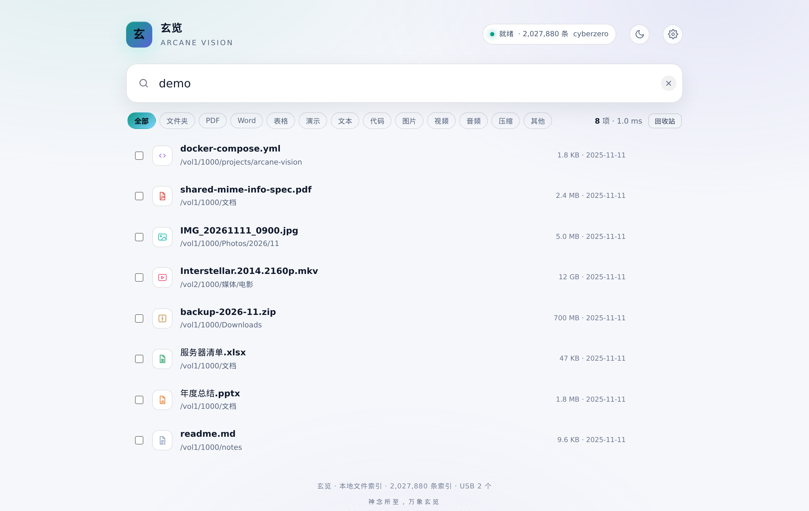
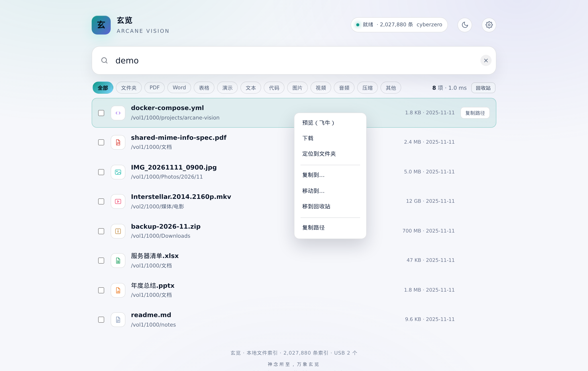
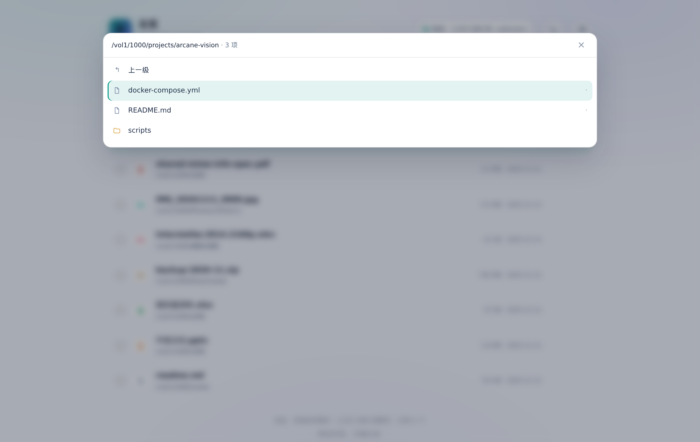
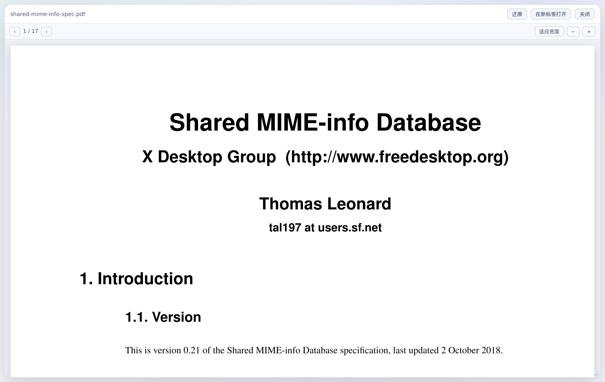
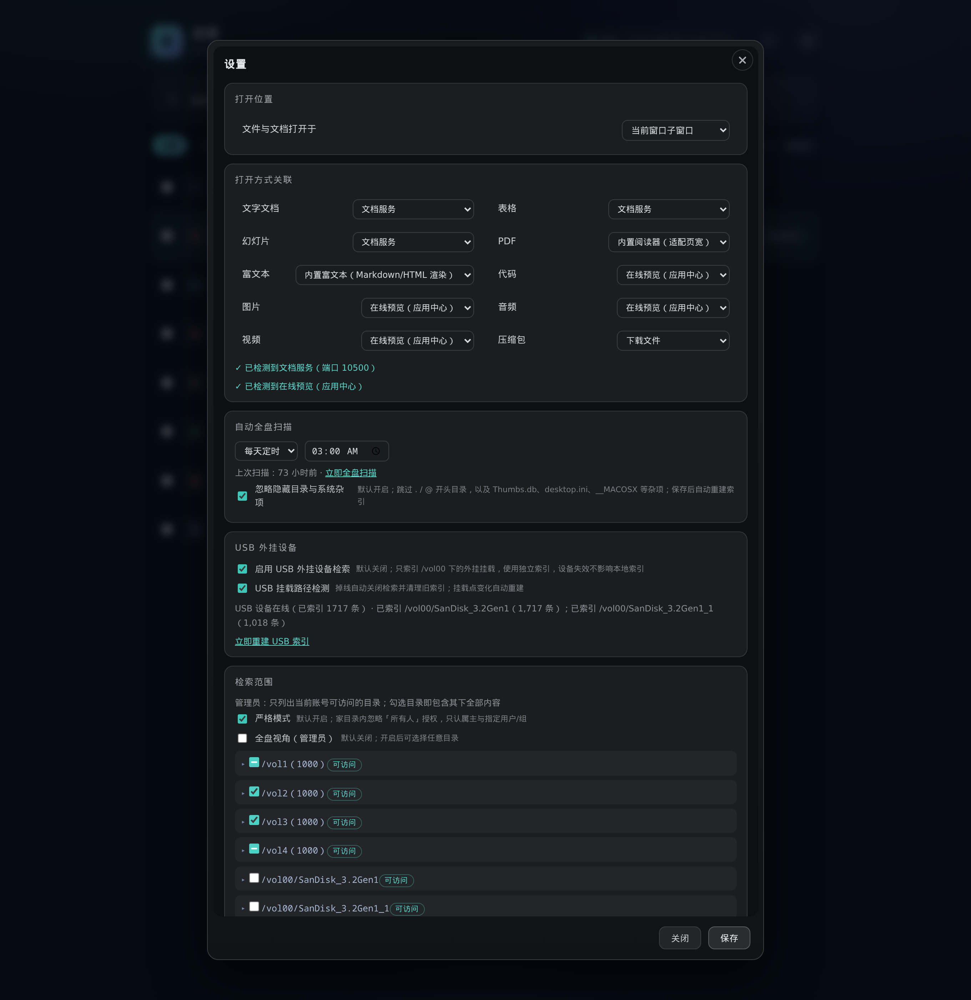
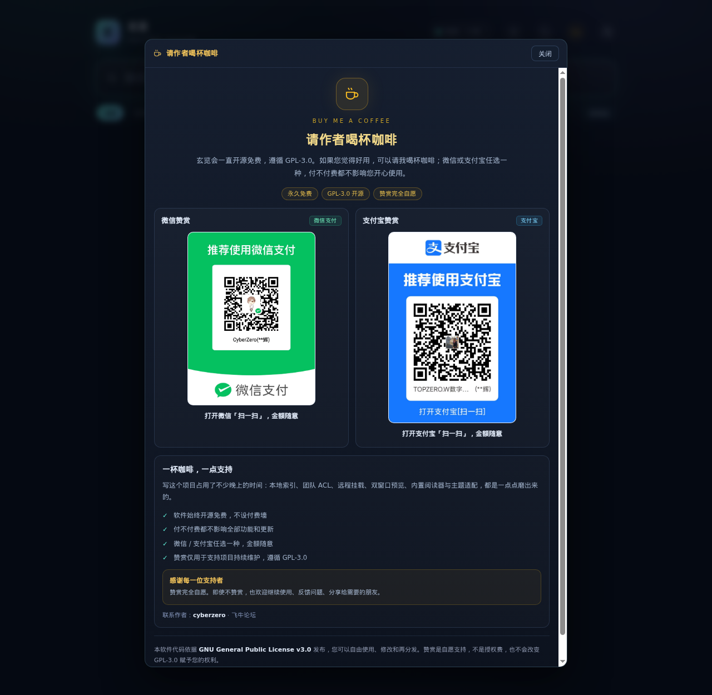

# 玄览 / Arcane Vision

[](https://github.com/magicindex/ArcaneVision/actions/workflows/ci.yml)

> 伫中区以玄览，颐情志于典坟。 —— 陆机《文赋》

飞牛 fnOS 上的全盘文件索引与毫秒级检索引擎。全新编写，不包含任何第三方项目的源代码。

作者：cyberzero　·　神念所至，万象玄览 / Spiritual Sense, All Things Revealed

## 功能

- **毫秒级检索**：直接读 ext4 元数据建索引，500 万条目规模下 3 字符以上查询通常 0.5–7 ms；
  索引记录文件大小与 mtime，结果按真实修改时间倒序
- **多卷统一**：自动探测 /vol1–/vol8 中实际挂载的卷，最多 8 卷合并为一棵结果树，按修改时间归并
- **按账号授权**：unix socket 上的飞牛身份头才可信，TCP 必须 Cookie 认证，否则 `/api/*` 一律 401；
  逐目录按 `system.trim_acl` 求值，家目录可开「严格模式」，忽略「所有人」授权
- **类型分类**：12 类图标与筛选条（文档/表格/演示/PDF/文本/代码/图片/视频/音频/压缩包…）
- **图片预览**：双击图片结果全屏查看（文件默认双击打开，可在设置改为单击），←/→ 切换、Esc 关闭、点击背景关闭，可直接下载；
  底部缩略图条列出当前搜索到的全部图片，当前项高亮、点击即切换；预览顺序沿用当前搜索结果，
  不重新拉取列表
- **鼠标操作**：桌面默认文件夹单击打开、文件/图片双击打开；设置 → 鼠标操作可分别改为
  单击/双击，触屏始终单击打开
- **视频预览**：内置播放器（浏览器直接打开/转码播放）控制条悬浮在画面底部，鼠标离开播放窗口即隐藏；空格暂停/播放，
  ←/→ 快退/快进 5 秒；在线转码流同样适用
- **团队空间隔离**：管理员可选共享 / 隔离 / 混合；混合模式默认共享，按组独立扫描，
  未分类组回退共享；隔离用户按单元索引检索，单元缺失不回退
- **即时预览**：内置 PDF 阅读器（按页宽适配）、EPUB 阅读器（章节/目录/图片）、
  Markdown 服务端渲染、文本/代码高亮底色、图片音视频直接播放；可关联飞牛「文档服务」
  「在线预览」；服务端转码支持 HDR→SDR 与纯音频
- **文件操作**：多选复制/移动/回收站，回收站支持恢复与清空
- **索引自维护**：fanotify 实时增量 + 定时全盘对账，索引落盘，重启秒开
- **隐藏项默认跳过**：`.` / `@` 开头的目录与文件（`@eaDir`、`.recycle` 等），以及
  `Thumbs.db`、`desktop.ini`、`__MACOSX` 等系统杂项默认不进索引；设置里可关闭，CLI 用
  `--include-hidden` 打开
- **明暗双主题**：标题栏一键切换，偏好保存在本地
- **USB 外挂检索**：可选开启（默认关、仅管理员可见），自动检测 fnOS `/vol00` 外接存储
  挂载并单独建索引；掉线自动关闭并清理，挂载路径变化自动重建，结果带 `USB` 标记
- **单文件 FPK**：随包提供 Web UI，安装后从飞牛桌面打开

## 界面

检索：输入即出结果，左侧为类型图标，右侧为大小与修改时间。



右键菜单：打开、下载、定位到文件夹、复制/移动/回收站。



定位到文件夹：在页内面板展开所在目录并高亮目标文件。



PDF 预览：内置 pdf.js，按页宽适配，可拖拽缩放或最大化。



图片预览：点击图片结果全屏查看，底部缩略图条按当前搜索顺序排列，点击切换，支持下载。


设置：打开位置、扫描模式、鼠标操作、10 类格式关联、自动全盘扫描、忽略隐藏目录与系统杂项、USB 外挂检索、检索范围与严格模式。



赞助：顶栏咖啡杯或页脚入口打开「请作者喝杯咖啡」，微信/支付宝赞赏位、亮暗主题与手机单列适配。



桌面鼠标默认：文件夹单击打开，文件/图片双击打开；可在「设置 → 鼠标操作」分别改为双击/单击。
触屏始终单击打开，不受该设置影响。

| 设置项 | 默认值 |
|---|---|
| 打开位置 | 当前窗口子窗口 |
| 扫描模式 | 共享（shared） |
| 文件夹打开 | 单击 |
| 文件 / 图片打开 | 双击 |
| 忽略隐藏目录与系统杂项 | 开启 |
| 严格模式 | 开启 |
| USB 外挂检索 | 关闭 |
| USB 挂载路径检测 | 开启 |
| 自动全盘扫描 | 每天 03:00 |
| 打开方式关联 | 代码/图片/音频/视频=在线预览；文档/表格/幻灯片=文档服务；PDF=内置阅读器；富文本=内置；压缩包=下载 |
| 视频控制条 | 鼠标离开播放窗口即隐藏 |

手机与桌面统一从飞牛网关进入：`https://<NAS>:5667/app/xuanlan/`。前端以当前页面路径解析
API、PDF worker、预览与下载地址，不依赖 `127.0.0.1:8971`。触屏下单击结果直接打开（不受
鼠标设置影响），右侧 `⋯` 打开操作面板；类型筛选横向滑动，页面滚动后右下角提供返回顶部按钮，
设置与定位面板在窄屏上占满可用高度，回收站面板贴边显示。

## PDF 阅读器

- 内置 pdf.js（Mozilla，Apache-2.0，见 `ui/vendor/LICENSE.pdfjs`），默认按页宽适配
- 设置齿轮图标取自 Feather Icons（MIT，见 `ui/vendor/LICENSE.feather-icons.txt`）
- 第三方组件与许可义务见 `THIRD_PARTY.md`，审计报告见 `docs/05-第三方与许可审计.md`
- 支持等比缩放、翻页；窗口拉宽/最大化后自动重排

## EPUB 阅读器

- `.epub` 默认使用内置阅读器，不再依赖飞牛「预览」应用；旧版 Android WebView（Chrome 83）
  也能打开
- 使用 fflate（MIT，见 `ui/vendor/LICENSE.fflate.txt`）在浏览器内解压，解析
  `container.xml` → OPF → spine，目录优先 EPUB3 `nav`、其次 EPUB2 `toc.ncx`
- 支持目录跳转、上一章/下一章、章节内锚点、跨章节链接与内嵌图片（`data:` URI）
- 安全：章节 HTML 白名单清洗（去脚本、iframe、事件属性、外链资源），iframe
  `sandbox` + CSP；DRM 加密、超大文件与 zip bomb 会被拒绝
- 限额：EPUB ≤ 64 MB、解压总量 ≤ 256 MB、生成 HTML ≤ 12 MB
- 已知不支持：DRM、分页/书签/批注、EPUB3 音视频与脚本；复杂 CSS 排版可能有差异
- 详细排查与实现见 [EPUB 预览说明](docs/07-EPUB-预览说明.md)

## Markdown 预览

- `.md`、`.markdown`、`.mdown`、`.mkd` 默认走服务端渲染，不再把源码塞进 `<pre>`
- 预览接口：`GET /api/markdown?path=/vol1/...&theme=light|dark`，返回自带主题的 HTML 页面；
  `/api/md` 是同一接口的别名
- 需要嵌入其他页面时用 `GET /api/markdown?...&format=json`，返回
  `{"ok":true,"html":"<h1>…</h1>","truncated":false}`
- 支持标题、段落、强调/删除线、行内代码、围栏代码块、引用、有序/无序列表、表格、分隔线、
  http(s)/mailto 链接与 http(s) 图片
- 安全：源文件中的原始 HTML 全部转义；`javascript:`、`data:` 等危险 URL 不生成标签；
  读取沿用文件级权限与 8 MB 上限

## 文件操作

- 结果行勾选多选：复制到…、移动到…、移到回收站
- 回收站：右上角入口，支持恢复选中与清空；删除均为移入回收站，不直接销毁
- 目标目录选择器复用 `/api/dir`，只列可访问目录

## 打开方式关联

设置 → 打开方式关联 按类型分组，每组可选择「文档服务 / 在线预览 / 内置 / 浏览器直接打开 /
下载」。0.8.5 新增 **富文本** 组：

- 覆盖 `txt`、`rtf`、`md`/`markdown`、`html`、`json`、`xml`、`log`、`ini` 等；
- 默认「内置富文本」：Markdown 服务端渲染；HTML 清洗后在 sandbox iframe 渲染（去脚本、
  事件属性与外链资源，CSP 兜底）；RTF 有文档服务时交给文档服务，否则内置纯文本解析；
  其余按文本查看；
- HTML 不会以同源页面裸渲染，即使选择「浏览器直接打开」或新窗口也一样；
- 0.8.4 的旧「文本」设置会自动映射到新的「富文本」组。

详情见 [富文本打开方式关联](docs/08-富文本关联.md)。

## 现在是什么状态

当前版本 **0.10.55（正式版）**，更新记录见 [CHANGELOG.md](CHANGELOG.md)，发布说明见
[RELEASE_NOTES.md](RELEASE_NOTES.md)。0.10.55 仅保留顶栏咖啡杯赞助入口；0.10.54 修复网关路径下赞赏码图片 404；0.10.53 增加「请作者喝杯咖啡」赞助入口与弹窗；0.10.52 播放关闭后恢复列表滚动位置；0.10.11 固定背景层并补齐 ext4 镜像测试；0.10.10 优化多词候选选择与高亮边界；0.10.9 修复多词分隔符与多词高亮；0.10.8 增加搜索结果自动分页加载；0.10.7 增加多词搜索；0.10.6 将 0.10.x 的团队独立索引、远程协议标识、
HLS 转码、分区域扫描统计和板块级重建收敛为正式版；0.9.0 完成团队空间按权限索引；
0.10.0 完成 fanotify ACL 自愈与修复退避。

### 方向

1. **快照是唯一检索路径**：不引入 MariaDB/PostgreSQL 作为检索后端；DB 最多作为未来的
   离线分析副本，不参与搜索、ACL 或索引构建。
2. **权限先于检索**：团队文件夹按 `system.trim_acl` 逐目录求值；无权限目录不进入该用户单元，
   查询期再做一次实时 ACL 复核，默认 fail-closed。
3. **管理员可控**：`shared` 单索引成本最低；`isolated` 每用户物理隔离；`hybrid` 默认共享、
   按组隔离、未分类回退共享。
4. **可运维**：单元索引有 epoch 原子切换、增量 delta、损坏检测/自动重建、容量告警、
   `.trash` 回收与一键回滚。
5. **不牺牲检索性能**：共享索引仍是 mmap + trigram；单元索引只读 mmap，增量走 live + delta。

### 0.10.55 正式版已完成

- 移除页脚「☕ 请作者喝杯咖啡」按钮；
- 赞助入口只保留顶栏咖啡杯。

### 0.10.54 正式版已完成

- 修复经 fnOS 网关以 `/app/xuanlan` 打开时赞赏码图片 404；
- 赞赏码改用页面 ROOT 绝对路径。

### 0.10.53 正式版已完成

- 顶栏咖啡杯按钮 + 页脚「请作者喝杯咖啡」入口；
- 赞助弹窗沿用 RAID 阵列健康赞助页 UI：咖啡杯主视觉、微信/支付宝赞赏位、支持说明；
- 弹窗内嵌微信/支付宝赞赏码，新增 `/assets/` 静态资源路由；
- 亮/暗主题、桌面双列与手机单列适配，ESC/遮罩/关闭按钮均可关闭。

### 0.10.52 正式版已完成

- 关闭视频/文档恢复列表滚动位置；
- 行点击前捕获 scrollY；
- 关闭后 requestAnimationFrame + setTimeout 恢复；
- 手机实测 700 → 700。

### 0.10.51 正式版已完成

- 夜间模式覆盖 daily/interval/idle；
- 关闭模式不生效；
- 夜间 0 小时三种模式均不扫描；
- UI 三种自动模式均显示夜间配置。

### 0.10.50 正式版已完成

- 扫描统计卡片边框/圆角/内边距；
- 夜间时间输入手机端自动换行；
- 版本同步。

### 0.10.49 正式版已完成

- 保存后同步本地 `settings.rebuild`；
- 夜间模式重开保持勾选；
- 闲置/夜间配置重启后保持；
- 实测保存重开与重启均通过。

### 0.10.48 正式版已完成

- 夜间模式勾选框始终可用；
- 勾选后自动切换到自定义周期；
- 不再需要先手动切换模式；
- 闲置/关闭模式下也可直接启用夜间模式。

### 0.10.47 正式版已完成

- 夜间模式入口始终显示；
- 仅自定义周期可启用夜间模式；
- 闲置扫描/夜间配置持久化修复延续；
- 提醒关闭旧页面避免缓存。

### 0.10.46 正式版已完成

- 自动扫描新增夜间模式；
- 夜间时段独立间隔，0 小时不扫描；
- 支持跨午夜；
- 配置持久化。

### 0.10.45 正式版已完成

- 首页设置旁新增刷新按钮；
- 手动发起全盘扫描；
- 扫描中旋转并防重复；
- 完成后刷新搜索结果。

### 0.10.44 正式版已完成

- 修复 idle 模式保存成 off；
- settings.json 正确持久化 `mode=idle`；
- 重启后自动扫描仍为闲置模式；
- 回归新增重启校验。

### 0.10.43 正式版已完成

- 版本号统一 0.10.43；
- 退出按钮与旋转按钮右侧对齐、边距 8px；
- FPK 重新打包；
- App Center / Gitea / GitHub 同步。

### 0.10.42 正式版已完成

- 退出按钮与旋转按钮右边距统一 8px；
- 两个按钮统一 34×34；
- 退出按钮 top/right 均为 8px；
- 同一右侧轴上下排列。

### 0.10.41 正式版已完成

- 退出按钮 top/right 统一 8px；
- bottom/left 为 auto；
- 右上角边距一致。

### 0.10.40 正式版已完成

- 退出按钮上移到 6px、右移到 8px；
- 去掉多余 safe-area 顶部内边距；
- 更贴近画面右上角。

### 0.10.39 正式版已完成

- 全屏退出按钮改到画面右上角；
- 仍随画面旋转；
- 仍跟随控件显示/隐藏。

### 0.10.38 正式版已完成

- 全屏退出按钮放入 vstage；
- 跟随画面旋转；
- 相对画面固定在左上角；
- 跟随控件隐藏；
- 不固定手机方向。

### 0.10.37 正式版已完成

- 播放窗口仍使用原顶栏关闭按钮；
- 不额外增加右上角关闭 X；
- 仅全屏模式右上角显示退出按钮。

### 0.10.36 正式版已完成

- 播放器关闭按钮改为右上角 X；
- 全屏退出按钮保持右上角；
- 顶栏布局不换行。

### 0.10.35 正式版已完成

- 全屏右上角退出按钮；
- 一键退出全屏；
- 移除横屏旋转，恢复竖屏；
- 按钮层级高于旋转舞台。

### 0.10.34 正式版已完成

- 2× 提示移到右上角；
- 仅文字、无背景、11px；
- 长按屏幕即可 2×，无需先显示控件；
- 控件隐藏时长按不唤出控件。

### 0.10.33 正式版已完成

- 控件显示时长按画面 2× 倍速；
- 屏幕提示“2× 倍速播放中”；
- 松开恢复 1×；
- 长按不触发播放/暂停。

### 0.10.32 正式版已完成

- 控件隐藏时第一次点击只显示控件；
- 控件显示时点击才播放/暂停；
- pointerdown 记录状态，避免触摸 mousemove 误暂停。

### 0.10.31 正式版已完成

- 横竖屏按钮悬浮右下方；
- vstage 旋转实现横屏/竖屏切换；
- 胶囊模式隐藏音量滑块，修复溢出；
- 转码标签单行。

### 0.10.30 正式版已完成

- 新增独立横竖屏切换按钮；
- 转码标签缩短为单行；
- 顶栏标题/标签/按钮均不换行；
- 全屏自动方向判断保留。

### 0.10.29 正式版已完成

- 分类标签单行横向滑动；
- 全屏按视频宽高锁定横屏或竖屏；
- 退出全屏解锁方向；
- 兼容旧版方向 API。

### 0.10.28 正式版已完成

- index.html 预压缩，gzip 后约 62KB；
- vendor JS 预压缩；
- 手机端延迟非关键请求；
- 手机状态轮询降至 5 秒；
- 短搜索框占位与移动端样式优化；
- 320/360/390/430 宽度无横向溢出。

### 0.10.27 正式版已完成

- 设置新增「点开视频自动播放」；
- 默认开启；
- 直出/HLS 都遵循；
- 关闭后停在首帧，手动播放；
- 设置随服务器保存。

### 0.10.26 正式版已完成

- 手机/窄屏播放器铺满视口，消除右侧裁切；
- 控制条与视频区域对齐；
- 完整模式控制条固定，不可拖动；
- 仅胶囊模式可拖动并复位；
- App Center 显示版本同步。

### 0.10.25 正式版已完成

- MKV 等已知容器跳过 ffprobe；
- 双击后立即显示播放器加载层；
- HLS 首段 1 秒、NVENC p1、低 probesize；
- 时长异步补齐，不阻塞打开；
- 实测打开 0.4s，2.2s 内播放。

### 0.10.24 正式版已完成

- HLS 播放后检查 videoWidth/播放进度；
- 8 秒无有效画面自动回退直出；
- MKV 强制转码保持；
- H.264 DTS MKV、H.265 HDR MKV 实测通过。

### 0.10.23 正式版已完成

- MKV/AVI/WMV/FLV/TS/M2TS/RMVB/3GP 强制转码；
- 修复 H.264 MKV 直接播放黑屏；
- H.265/HDR MKV 继续 HLS 转码；
- Chromium 实测 MKV HLS readyState=4 播放成功。

### 0.10.22 正式版已完成

- 修复 `.openwin` CSS 缺失右括号导致 `.openwin.on` 被解析丢弃；
- 双击视频恢复显示播放器；
- Chromium 实测直出文件和 HLS 转码均正常播放；
- 窗口 600×420，控制条完整可见。

### 0.10.21 正式版已完成

- HLS 启动/播放失败自动回退直出转码；
- 关闭/回退时 `/api/hls/stop` 回收 ffmpeg；
- 同路径会话先回收旧进程；
- 120 秒无分段请求自动清理；
- 不支持 Hls.js 时直接使用直出转码。

### 0.10.20 正式版已完成

- 播放器窗口最小尺寸 600×420；
- 最小尺寸下隐藏横/纵滚动条；
- 初始化与恢复均按夹取后的最小尺寸保存；
- 窗口控件完整可见，底部不截断。

### 0.10.19 正式版已完成

- 播放器窗口初始最小尺寸 560×360；
- 旧本地尺寸小于最小值时自动夹取；
- 窗口 `overflow:hidden`，不出现滚动条；
- 记住上次窗口大小，最小不低于初始化最小值；
- 视口缩放时自动夹取尺寸；
- 控件完整可见，底部不截断。

### 0.10.18 正式版已完成

- 胶囊/完整模式切换时清空拖拽位置；
- 点击胶囊按钮回到默认底部/居中位置；
- 默认样式不继承上次拖拽；
- 完整回归通过。

### 0.10.17 正式版已完成

- 修复 `vcompact` 在 `const` 声明前被访问的 ReferenceError；
- 设置齿轮恢复响应；
- 播放器图标初始化顺序修正。

### 0.10.16 正式版已完成

- 「静音」「胶囊」按钮改为图标；
- 悬停显示功能提示；
- 静音图标随状态变化，胶囊按钮提示随展开/收起变化；
- 静音时音量滑块禁用、取消静音恢复音量保持。

### 0.10.15 正式版已完成

- 静音后音量滑块置灰并禁止操作；
- 取消静音恢复滑块可用；
- 自动恢复静音前保存的音量；
- 音量与静音状态继续分别持久化。

### 0.10.14 正式版已完成

- 胶囊控制条保留音量滑块与静音按钮；
- 音量输入实时生效；
- 音量与静音状态分别写入 `xl_video_volume` / `xl_video_muted`；
- 打开视频、切换静音、刷新后恢复上次音量；
- 静音时滑块仍显示可恢复音量。

### 0.10.13 正式版已完成

- 搜索长列表增量追加 DOM，滚动不再重建整表；
- `content-visibility:auto` 只渲染视口行；
- 修复 live 增量与基线重复导致 total 大于可加载条目的问题；
- 新增 `tests/pagination_test.py`：1200 条分页 total、数量、唯一路径校验；
- 固定背景层和自动加载提示保持；
- 完整回归（含 ext4）通过。

### 0.10.12 正式版已完成

- 搜索结果按页增量追加 DOM，不再每次加载重建整个列表；
- 列表行启用 `content-visibility:auto`，长列表滚动只绘制可视区域；
- 固定背景层只随视口绘制，搜索结果滚动不再带动背景重绘；
- 自动加载失败/无新数据停止，避免长列表反复请求；
- 分页、排序和选择状态保持。

### 0.10.11 正式版已完成

- 背景改为固定视口 `body::before`，仅内容滚动；
- 避免背景随搜索结果滚动重复绘制，降低内存/渲染开销；
- 暗色/亮色主题均使用固定背景层；
- ext4 镜像测试补充 `--entrypoint bash`，裸设备扫描与 getdents 全量对齐；
- 完整回归与 UI 固定背景断言通过。

### 0.10.10 正式版已完成

- 多词查询按最稀有 trigram 选择候选词，优先扫描小 posting；
- 增加全角空格分隔符；
- 搜索自动加载在无新数据/失败时停止，避免反复请求；
- 多词高亮覆盖英文/中文逗号、顿号、空格及引号词组；
- 完整回归通过，真实索引搜索冒烟正常。

### 0.10.9 正式版已完成

- 多词分隔符统一支持空格、英文逗号 `,`、中文逗号 `，`、顿号 `、`；
- 连续分隔符自动合并，不再多跳字符或截断 UTF-8；
- 修复 `alpha,beta` 被解析成 `alpha` + `ta`；
- 修复 `测试，文档`、`测试、文档` 搜索失败；
- 搜索结果按每个关键词分别高亮，引号词组整体高亮；
- 单一命中 total 去重，重复关键词不重复计数；
- 新增混排与连续分隔符测试用例，完整回归通过。

### 0.10.8 正式版已完成

- 搜索首屏从 200 条提升到 500 条；
- 结果未显示完时自动继续请求后续分页；
- 加载期间显示「正在加载更多… 已显示 X / Y」；
- 自动加载失败停止重试，避免反复请求；
- 超大结果集自动加载到 5000 条后保留「继续加载」，防止浏览器卡死；
- UI 回归新增自动加载/分页大小断言。

### 0.10.7 正式版已完成

- 多词搜索：空格分隔、多个词同时命中；可切换单一命中；
- 支持双引号精确词组、中文/英文混合、空格/英文逗号/中文逗号/顿号分隔；
- 可配置区分英文大小写、按出现顺序匹配；
- 设置页最下方新增「高级搜索」面板，含详细示例和说明；
- 自动全盘扫描支持「自定义周期」和「闲置时扫描」：
  闲置模式检查 CPU 负载、可用内存、磁盘 IO，连续空闲 60 秒且 60 秒内无查询才启动；
- 自动扫描默认关闭，可手动开启；
- 后台 `/api/settings` 持久化 `searchMulti` / `searchMatchAll` /
  `searchSeparator` / `searchCaseSensitive` / `searchOrdered`；
- 新增 `tests/multisearch_test.py`，覆盖全部/任一、引号、大小写、顺序、分隔符；
- 完整回归通过（ext4 镜像测试仍受本机 Docker 镜像限制）。

详细语法见 [多词搜索](docs/11-多词搜索.md)。

### 0.10.6 正式版已完成

#### 软件迭代

- 团队文件从本地共享索引中独立为 `team-volN.idx`，团队搜索和团队重建互不影响本地卷；
- 本地 / 团队 / 外接存储 / 远程挂载四个板块各自提供重建按钮；
- 定时重建对四个板块全部生效，按本地/团队 → 外接 → 远程顺序执行；
- 自动扫描卡显示本地、团队、外接、远程各自的条目数和耗时；
- 远程路径在挂载卡片、搜索结果、文件查找器、目录选择器前显示 SMB / NFS / WebDAV；
- PDF 工具栏新增「显示全部」，按可用宽高自适应整页；
- 视频默认内置播放器，控制条支持胶囊样式、拖动位置和播放中自动隐藏；
- 视频改用 HLS 分段转码，hls.js 按应用根路径动态加载，支持无感拖动；
- 视频画面改用 canvas 渲染，隐藏系统原生 1x/扬声器控制条，避免遮挡字幕；
- 修复启动时卷未挂载导致只列出 `/vol1`、`/vol3`；启动等待 `/vol1–/vol4`；
- 修复团队路径不进入共享检索、`hls.js` 在 `/app/xuanlan` 路径下 404 等问题。

#### 进程与运行方式

```text
systemd xuanlan.service
  -> /vol1/@appcenter/xuanlan/start.sh
  -> bin/xuanlan serve
```

- 单机单进程，无数据库、无独立检索服务；
- 默认端口 8971，可由 `service_port` 覆盖；
- HTTP/unix socket、构建、单元、fanotify、远程对账、USB 由同一进程内的线程协作；
- 构建线程 `nice=19` + idle IO 优先级，单元之间让出 150ms；
- 单元构建使用短锁快照，构建期间 `/api/status` 保持亚毫秒级响应；
- 服务重启保留 `/vol1/@appdata/xuanlan` 下的索引和设置。

#### 资源与查询速度对比

| 模式 | 查询速度 | 磁盘 / 内存 | 构建成本 | 适用场景 |
|---|---|---|---|---|
| 共享 | 最快：单索引 + 查询期 ACL 裁剪 | 约 1× | 约 1× | 家庭、多用户日常 |
| 隔离 | 快：直接读本人索引 | 约用户数× | 约用户数× | 少数敏感用户 |
| 混合 | 共享用户同共享；隔离用户/组读各自索引 | 约 1× + 每个隔离单元 1× | 约 1× + 每个隔离单元 1× | 团队/部门分组隔离 |

- 共享模式仍是默认推荐，查询路径最短；
- 隔离模式查询无需 ACL 裁剪，但用户越多磁盘/内存/构建成本越高；
- 混合模式只给被隔离的用户/组增加单元，未分组用户仍走共享。

#### 本轮修复

- 修复启动早于卷挂载时本地列表不全；
- 修复团队文件独立索引后搜索为空；
- 修复各板块重建互相影响；
- 修复扫描模式选中区域对比度不足，改为粉红边框/左条；
- 修复视频原生控件无法隐藏、控制条不自动隐藏；
- 修复 HLS 首次播放失败、HLS fatal 无回退；
- 修复远程协议标识只在挂载卡片显示；
- 修复 hybrid 旧配置回退标志、组单元和组路由兼容。

#### 0.10.5 已完成

- 设置页新增「团队文件」卡片；
- 团队文件夹独立启用/关闭；
- 自动列出 `/volN/@team/*`；
- 关闭后团队内容不参与搜索，索引保留。

### 0.10.4 已完成

- 移除安装/卸载 wizard，默认端口 8971；
- `fnos-cli app uninstall xuanlan --yes` 可直接成功；
- 卸载保留 `/vol1/@appdata/xuanlan` 数据；
- 重新安装无需 custom parameters，版本 0.10.4 running。

### 0.10.3 已完成

- 检索范围拆为本地 / 挂载 / 远程三张卡片；
- 三路独立开关，默认仅本地启用；
- 关闭某一路不影响其他路搜索与索引；
- 远程默认关闭，需设置页显式开启。

### 0.10.2 已完成

- 版本号 0.10.2；
- App Center 干净卸载/重装回归：数据、配置、远程索引保留；
- 升级路径结论：App Center UI 可卸载；`fnos-cli` 对带 wizard 的应用仍需 UI 参数；
- FnOSF10 安装 0.10.2 完成。

### 0.10.1 已完成

- 快照全文件 FNV-1a checksum：保存回写、打开校验，损坏立即拒绝；
- 容量/修复趋势采样：`/api/status.trend`，最近 60 点，管理端趋势条；
- 修复失败按单元指数退避；
- FnOSF10 本机 FPK 应用中心安装 0.10.1 完成；
- 快照 checksum 对旧 checksum=0 快照保持兼容；
- **子树级 ACL 增量重建**：ACL/xattr 变化只重扫变化路径所在的单元子树，合并旧快照后原子替换，
  不再触发共享索引/整卷重建；
- `/api/status.live.aclEvents` / `aclDirty` 可观测；
- **远程挂载 provider（MVP）**：检测 `/vol02` 下 CIFS/NFS/NFS4/WebDAV 挂载，
  `/api/remote` 列出；设置 `XL_REMOTE_INDEX=1` 时纳入共享索引；
- 远程卷按 `/vol02/<uid>-...` 做 **owner-only** 过滤，管理员可读；不进入隔离单元；
- 远程健康检查每 60 秒；不可达超过 TTL（默认 300 秒）后隐藏旧索引；
- 管理端设置页新增「远程挂载」卡片：启用/关闭开关、立即重建按钮、路径/类型/owner/索引状态/离线状态；
- 远程索引每 `XL_REMOTE_SYNC_SEC`（默认 900 秒）自动对账重建，只重建远程卷，不扫描本地共享；
- 远程挂载生命周期：周期对账时新增挂载、同 source 换挂载点迁移、掉线/卸载自动清理索引。

### 0.10.0 已完成

- **fanotify ACL 自愈**：`FAN_ATTRIB` 属性/ACL 变化进入脏标记，静默 5 秒后只重建一次；
- **批量 ACL 合并**：5000 个文件 chmod 只触发 1 次重建；
- **压力防护**：单元事件队列 4096 → 16384；队列溢出记录 dropped 并触发重建；
- **压力验证**：5000 文件快速创建，最终队列 0、dropped 0、delta 约 857KB；
- **修复按单元退避**：`/api/status.repair.units` 展示单元失败次数/重试倒计时，
  失败后指数退避（最长 300 秒），成功后清除；
- **单元构建进度**：`/api/status.unitBuild`；管理端状态行显示；
- **组单元 ACL 批量读取**：无 ACL 时只读一次 xattr；
- **FPK 应用中心安装回归**：FnOSF10 本机正式安装 0.10.0 成功，服务和候选 API 正常。

### 0.9.0 已完成

- **团队空间扫描**：`scanMode != shared` 时放行卷根 `@team`，快照头记录 `XL_HDR_TEAM`；
  旧快照自动重建。
- **三种模式**：`shared` / `isolated` / `hybrid`；hybrid 下 `isolatedGroups` 按组独立扫描，
  `shareGroups` 与未分类用户回退共享。
- **按单元独立扫描**：`scan_tree_scoped()` 按主体 `x` 权限进入目录，不再从共享快照过滤。
- **独立单元索引**：`idx/units/u<uid>/volN.idx`、`g<gid>/volN.idx` + `unit.json`；
  组单元按成员 ACL **精确交集**生成。
- **QueryRouter**：`/api/search` 与 `/api/dir` 按 uid 路由到共享或单元索引；
  多单元合并去重；单元缺失/损坏 fail-closed，不回退共享。
- **epoch 原子切换**：单元缓存按 `unit.json`/delta 的纳秒 mtime 加载新版本，旧请求按引用计数
  延迟释放，不中断查询。
- **实时增量**：fanotify → 全局 live + 单元 `delta.log`；查询合并，删除走墓碑/前缀删除。
- **事件队列**：live 回调只入队，writer 线程批量写 delta，避免 live 锁内同步 IO。
- **delta 运维**：按路径保留最后事件的压缩、16MB 上限、容量告警、`units gc/rollback/stats/compact`。
- **损坏自愈**：加载期 + 周期 `units check`；损坏单元进入修复队列，后台重建；
  `/api/status.repair` 暴露 queued/dropped/failed。
- **管理端**：扫描模式、自动检测 `/@team` 团队目录与用户组/用户候选、勾选 share/isolated 分类、
  容量/修复/事件队列状态、回滚到共享；候选依据在页面展示。
- **测试**：新增 route / scanmode / unitbuild / unitdelta / group-intersection / epoch /
  units-admin / repair / UI 静态回归，全部接入 `make test`。

### 0.10.0 后续（未完成）

- [x] 快照 checksum / 更完整损坏检测；
- [x] 子树级 ACL 增量重建（单元快照子树合并）；
- [x] 容量/修复趋势图（/api/status.trend + 管理端趋势条）；
- [x] 远程挂载 provider（CIFS/NFS/WebDAV，owner-only MVP）。

### 正在做 / 下一步

- 真机 fanotify 端到端已完成首轮（新增/删除/批量/重启恢复）；继续补 ACL 变更事件与压力测试。
- 候选检测继续扩展共享目录/ACL user ACE 依据；容量/修复趋势可视化。
- 单元健康检查的调度与 IO 限速（当前默认 60 秒、可用 `XL_UNITS_CHECK_SEC` 调整）。
- 继续优化单元构建：目录级 ACL 缓存、构建并发/错峰、进度上报。
- 组交集语义的产品确认：当前是“所有成员都可读”的公共范围；若需要成员并集需另设模式。
- 远程挂载 provider 仍是设计稿（见 docs/09 §9），尚未接入 CIFS/NFS/WebDAV。

### 未完成 / 已知限制

- **索引 v3 的 `rec_scope` / `scope_masks` / 每用户 view 尚未实现**；当前 shared 仍走查询期
  ACL，单元模式走独立快照（docs/09 §8 已标注为未来设计）。
- P10 可选离线分析副本（CSV/Parquet/DB）未做；DB 不进入运行时依赖。
- 快照没有 checksum；损坏检测覆盖头部/记录范围，mmap 后原地截断仍可能 SIGBUS。
- 单元独立扫描是 N 倍 IO；未做并发限速/错峰。
- 组单元为精确交集，成员个人额外可见数据不进入组索引。
- 远程挂载、SMB/CIFS、全文检索、索引加密仍不在本期范围。
- UI 截图仍是 0.8.x 设置页，未包含扫描模式卡片。

### 0.10.6 正式版发布检查项

- [x] 编译 + `smoke` / `api` / `scanmode` / `route` / `unitbuild` / `epoch` /
      `unitdelta` / `group-intersection` / `units-admin` / `repair` / `ui` 回归
- [x] docs/09 §8 标注为未来设计，与当前实现对齐
- [x] 版本号 0.10.52、README / CHANGELOG / RELEASE_NOTES
- [x] 真机 fanotify → 队列 → 批量 delta → 重启恢复（docs/10）
- [x] FPK 构建：`dist/xuanlan_0.10.52_amd64.fpk`
- [x] Gitea 推送 + tag `v0.10.52` + Release
- [x] GitHub 推送 + tag `v0.10.52` + Release

### 0.8.9–0.8.17 更新内容（历史）

- 开机自启：`xuanlan.service` 改由随包 `start.sh` 读取 `service_port` / `xuanlan.conf`，
  不再写死 8971 与 `/vol1–4`
- 检索范围目录树：父级全选/半选/未选三态修正，勾选继承逐级传递，保存时收敛重复子项
- 索引默认忽略 `.` / `@` 隐藏目录与 `Thumbs.db`、`desktop.ini`、`__MACOSX` 等系统杂项，
  设置页可关闭；快照头记录扫描规则，升级自动重建
- USB 外挂设备检索：默认关闭，`/vol00` 挂载单独建索引；掉线自动关闭并清理，挂载点变化
  自动重建，结果带 `USB` 标记
- 设置页：功能区卡片化、卡片内外灰度分层、右上角关闭按钮重做

### 0.8.18–0.8.35 更新内容

- 0.8.18：修复 ext4 裸扫目录块堆越界；设置请求上限 128 KiB、检索范围上限 512；普通用户
  可保存自己的 scope；拒绝复制到自身子目录与 FIFO 阻塞；fanotify 队列满触发重建；
  USB 掉线自动关闭加 2 次防抖
- 0.8.19：搜索结果分页；目录截断提示；写接口 JSON 校验；USB 仅管理员可见、每次挂载重建；
  构建进度按线程隔离；管理员判定缓存 60 秒刷新
- 0.8.20：USB 状态消息不再向普通账号暴露挂载路径
- 0.8.21：USB 分区在检索范围树中合并为单一根节点，不再平铺分区内容
- 0.8.22–0.8.23：检索范围树只显示目录，不再显示文件数量/「没有子目录」提示，展开深度
  放开到 32 层
- 0.8.24：自动探测 `/vol1–/vol8` 实际挂载点，修复 GitHub #2 多卷只识别前 4 个；残留空目录
  不会被误当卷
- 0.8.25：USB 设备 sysfs 校验、搜索按 uid 限流、USB 状态消息加锁、快照记录边界校验、
  复制不再保留 setuid/setgid
- 0.8.26：systemd unit 按实际安装路径生成（不再写死 `/vol1`）；目录/检索范围展开改用
  parent→child 索引，只遍历直接子项
- 0.8.27：图片全屏预览，支持左右切换/键盘操作/下载，预览顺序沿用当前搜索结果
- 0.8.28：图片预览底部缩略图条，当前项高亮、点击切换；`/api/thumb` 服务端缓存缩略图
- 0.8.29：修复缩略图黑框（主图 CSS 误作用于缩略图）
- 0.8.30：缩略图加载优化；主图优先、缩略图 HTTP 缓存、单线程快速缩放
- 0.8.31：图片全屏预览背景改为不透明，完全遮住列表
- 0.8.32：socket 对端校验收紧到 uid；admin 判定以网关头为准、兜底可关闭；新增 HTTP API 回归测试
- 0.8.33：图片预览跟随明暗主题；亮色主题使用浅色背景与深色按钮
- 0.8.34：首页 USB 状态指示（未检测/已连接/索引中）、保存成功提示、重建前检查挂载
- 0.8.35：USB 建索引期间检索范围也显示分区根节点

### 0.8.x 历史问题清单

> 更新：2026-11-13 · 历史快照；0.9.0 的当前状态见上节。来源：0.8.17 代码审查、真机 U 盘测试、
> GitHub Issues #1/#2、README 已知限制。

#### 已完成（0.8.18–0.8.35，历史）

- [x] P0：ext4 裸扫目录块数组堆越界（ASan + 64 MiB 镜像可复现）— 0.8.18
- [x] 设置 POST 超 16 KiB 静默截断、检索范围 64 项硬上限 — 0.8.18（128 KiB / 512 项，超限报错）
- [x] 普通用户无法保存自己的检索范围 — 0.8.18
- [x] 复制目录到自身子目录导致递归、FIFO/特殊文件阻塞 worker — 0.8.18
- [x] fanotify 内部事件队列满时静默丢事件 — 0.8.18（触发整卷重建）
- [x] USB 路径检测开关语义、掉线误判 — 0.8.18（开关同时控制重建，2 次防抖）
- [x] 搜索无分页、目录超过 4000 项无提示 — 0.8.19
- [x] 设置/文件操作/回收站 JSON 校验收紧 — 0.8.19
- [x] USB 对普通账号可见、复用过期索引快照 — 0.8.19（仅管理员、每次挂载重建）
- [x] 构建进度串扰、管理员判定永久缓存 — 0.8.19（线程隔离 / 60 秒刷新）
- [x] USB 状态消息泄漏挂载路径 — 0.8.20
- [x] USB 分区在检索范围树被平铺 — 0.8.21（按分区合并为根节点）
- [x] 只有文件的目录提示、目录树 3 层深度限制 — 0.8.22–0.8.23（只显示目录，展开 32 层）
- [x] GitHub #1「不支持外接硬盘」— 0.8.13 起支持，0.8.23 真机 SanDisk 双分区验证
- [x] GitHub #2「5 个内部卷只识别前 4 个」— 0.8.24 自动探测 `/vol1–/vol8` 实际挂载点
- [x] USB 仅按 `/vol00` 路径识别 — 0.8.25 增加 sysfs removable/USB 校验
- [x] 搜索无速率限制 — 0.8.25 每 uid 20 次/秒，2 字符 5 次/秒
- [x] USB 状态消息并发写 — 0.8.25 加锁
- [x] 快照逐记录边界校验 — 0.8.25 打开时校验 `name_off/name_len/parent`
- [x] unix socket 对端接受 www-data 组 — 0.8.32 收紧为仅 uid
- [x] 管理员判定仅靠最小 uid 兜底 — 0.8.32 网关头优先，`XL_ADMIN_FALLBACK=0` 可关闭
- [x] 无 HTTP API 测试 — 0.8.32 新增 `tests/api_test.py` 并接入 `make test`
- [x] README 截图过期 — 重拍检索/右键/定位/PDF/设置，并新增图片预览截图
- [x] CI 未接 — 新增 `.github/workflows/ci.yml`，跑 build、markdown、smoke、API、ASan smoke
- [x] ext4 裸扫接入 CI — privileged Docker job，构建 Debian 镜像后跑镜像测试
- [x] USB 挂载模拟接入 CI — tmpfs 挂载到 `/vol00/fake`，验证启用/索引/USB 搜索结果
- [x] 复制保留 setgid/setuid — 0.8.25 只保留 `0777` 权限
- [x] systemd unit / 应用中心路径写死 `/vol1` — 0.8.26 按实际安装路径生成 unit
- [x] 目录列举与检索范围展开 O(N) — 0.8.26 建立 parent→child 索引

#### 待处理（历史）

| 优先级 | 问题 | 状态 | 计划 |
|---|---|---|---|
| **P3** | USB 真机（实体 U 盘）回归 | ⬜ 待办 | CI 已用 tmpfs 模拟挂载；实体 U 盘的 removable/sysfs 校验仍需本地手测 |

#### 暂不列入短期计划（能力边界）

- USB 外挂索引没有 fanotify 实时增量，新增文件依赖手动重建或重新插拔
- USB 识别依赖飞牛把外接存储挂在 `/vol00` 下；官方调整路径需同步适配
- 不索引 SMB/CIFS、无全文检索、索引不加密、单机单进程；详见上方“已知问题与限制”

### 0.8.8 更新内容

- 打开方式关联默认值：代码/图片/音频/视频 = 在线预览，文字文档/表格/幻灯片 = 文档服务，
  PDF = 内置阅读器，富文本 = 内置富文本，压缩包 = 下载文件
- 未检测到文档服务或在线预览时，实际打开自动回退「浏览器直接打开」，不再弹安装提示；
  设置页保留原偏好并显示提示，应用装好后自动恢复

### 0.8.7 更新内容

- 修复 0.8.6 的越权显示：`Administrators` 组整卷放行后，检索范围把其他用户家目录
  （`/vol1/1001`、`/vol1/1002`…）和 `/vol1/docker` 也标成「可访问」
- 改为只对自家目录 `/volN/<uid>` 及其子路径放行读/穿越，其他家目录仍拒绝；只放行读，
  写操作仍按原 ACL
- 管理员仍能搜到 `/vol1/1000/NextCloud/data/...`（位于自己家目录内、由 www-data 持有、
  只授 owner 的子树）；`/api/acl` 对 uid 1000 只返回 `/vol1/1000` 及同 uid 的其它卷家目录

### 0.8.6 更新内容

- 修复：管理员（`Administrators` 组成员）搜不到实际可读文件。内核允许管理员组跨过
  TrimACL 读取整卷，玄览原先只按 ACE/属主判定，把 NextCloud `data` 等目录整棵过滤
- 0.8.7 将放行范围收紧为「自家目录」，避免检索范围列出其他用户家目录
- 复现与验证：以 uid 1000 搜索 `工程施工派工单` 原先返回 0 条，修正后返回 1 条；
  uid 1001 / 12345 仍返回 0 条

### 0.8.5 更新内容

- 打开方式关联新增「富文本」组：`txt/text/rtf/md/markdown/mdx/html/xhtml/json/xml/log/...`，
  可选 内置富文本 / 文档服务 / 浏览器直接打开 / 在线预览 / 下载，默认内置
- 内置富文本：Markdown 渲染、HTML 清洗后 sandbox 渲染（GBK 等编码自动识别）、RTF 纯文本解析
- 安全：HTML 去脚本/iframe/表单/事件属性/外链资源，`sandbox` + CSP，禁止同源裸渲染
- 兼容：旧 `openWith.text` 自动映射到 `rich`；`html/json/xml` 从「代码」组移入，`rtf` 从
  「文字文档」组移入，避免同一扩展名重复出现
- 细节见 [富文本打开方式关联](docs/08-富文本关联.md)

### 0.8.4 更新内容

- 新增内置 EPUB 阅读器：fflate 解压 + 解析 container/OPF/spine，支持目录、章节跳转、
  内嵌图片与跨章链接；纯前端实现，不增加服务端依赖
- 安全：章节 HTML 白名单清洗、iframe `sandbox` + CSP、DRM 检测、zip bomb 与体积限额
- 修复：0.8.3 把 EPUB 交给「预览」应用，而该应用前端使用 Chrome 85+ 的 `??=`/`||=`，
  在 Chrome 83 上语法报错、连文件接口都没发出；现在 EPUB 默认走内置阅读器
- 排障与实现细节见 [EPUB 预览说明](docs/07-EPUB-预览说明.md)

### 0.8.3 更新内容

- 新增 Markdown 预览接口与前端接入，`.md/.markdown/.mdown/.mkd` 直接渲染
- 修复旧版 Android WebView 浮层不可见：不再依赖 CSS `inset` 简写，`100dvh` 补 `vh` 回退
- EPUB/XPS/DjVu/FB2 等无内置阅读器的格式改为提示下载或转交在线预览

### 0.8.3 修复说明

荣耀（Android 10 内置 WebView，Chrome 83）上「可以搜索、点结果没反应」，不是接口问题：
网关日志显示点击后 `/api/dir`、`/api/file` 都已到达服务端并返回 200。真正原因是浮层用了
Chrome 87 才支持的 CSS `inset` 简写，旧内核直接忽略，子窗口/定位/设置面板失去位置和尺寸，
看起来就没有打开。0.8.3 改为 `top/right/bottom/left` 长写，并给 `100dvh` 补 `vh` 回退；
完整排查过程、证据与验证方法见 [0.8.3 修复说明](docs/06-0.8.3-修复说明.md)。

### 0.8.2 更新内容

- 手机端：类型筛选改为单行横向滚动，右侧保留下一项提示；结果行提供 `⋯` 操作面板；
  触屏单击直接打开，不再需要双击
- 手机端：设置、定位到文件夹、回收站面板适配安全区与 `100dvh`；设置增加固定关闭按钮，
  窄屏下打开方式下拉不再截断
- 手机端：新增一键返回顶部按钮；滚动超过 360px 显示，多选时自动隐藏
- 网关：`/app/xuanlan`、`/app/xuanlan/`、`/app/xuanlan/index.html` 三种入口均可正确解析
  API、PDF worker、预览与下载地址，不依赖 `127.0.0.1:8971`
- 修复：目录不存在时返回 `not found`，搜索跳过已删除/已卸载的索引残留路径

0.8.1 修复 SMB/ZFile 迁移目录中 mode 000 文件被误过滤、目录显示为空的问题。
### 0.8.1 修复内容

- 修复 SMB/ZFile 迁移目录中文件模式为 `000`、但属主经 TRIM ACL 仍可读时，
  目录列表把文件全部过滤掉、界面显示「该文件夹没有可见内容」的问题。
- 请求不存在的目录返回 `not found`，不再返回空列表；搜索会跳过已删除或已卸载的残留索引路径。
- 0.8.1 不改变索引格式（仍为 v2），从 0.8.0 升级不需要重新全量重建。

0.8.0 起索引升级到 v2（记录真实 `size/mtime`），从 0.7.x 升级后首次启动会自动全量重建一次；
按 4.9M 条实测约 25–30 分钟，重建期间服务可响应但结果会暂时变少。升级前建议备份 `idx` 目录。

P0–P6 已跑通：扫描（目录遍历 + ext4 裸设备）→ 建索引 → 落盘 → mmap 加载 → 查询
→ fanotify 增量 → TrimACL 求值 → HTTP 服务 + Web UI，并已打成可安装的飞牛 FPK。
全部是本仓库自己的代码，纯 C11 + glibc，服务端无第三方依赖、无 Qt。

ext4 裸设备读取器已用 `/dev/dm-1` 全卷验证：369 万条记录与 `find -xdev` 逐路径一致，
扫描 4.3 s（热）／33 s（无缓存），详见 `docs/03-P1实测.md`。

增量与权限的实现细节见 `docs/04-P2增量与ACL.md`。

## 已知问题与限制

以下问题已知、未隐藏，按影响从大到小排列。欢迎在 Issue 里补充复现条件。

**安全**

- 8971 端口只绑定 `127.0.0.1`。身份头（`X-Trim-Userid` 等）只在 unix socket 上可信；
  TCP 连接必须通过 Trim 登录 Cookie 认证，否则所有 `/api/*` 返回 401（fail-closed）。
  生产环境仍建议通过 NAS 网关（unix socket，已做 `SO_PEERCRED` 校验）访问。
- 状态变更接口（重建索引、全局设置、清空回收站）仅管理员可用；设置/文件操作/回收站写接口
  要求 `Content-Type: application/json`，防止简单表单 CSRF。
- 索引文件不加密。能读到 `<数据目录>/idx` 的人可以看到文件名、路径、大小与修改时间，但看不到文件内容。
- `serve --no-tcp` 可完全关闭回环 TCP，仅保留 unix socket；经 NAS 网关部署时建议启用。
- 索引 v2 记录真实 size/mtime；旧 v1 索引启动时会被拒绝并触发一次全量重建。

**能力边界**

- 不索引 SMB/CIFS 挂载与 `/fs`（trimafs）；网络共享需要先挂到本地卷。
- 不索引文件内容（没有全文检索）；仅按文件名、类型、路径检索。
- 服务端转码支持纯音频与 HDR→SDR（需要 ffmpeg 的 zscale 滤镜）；HDR 转换失败时回退为
  普通 8-bit 转换，颜色可能偏淡。
- 索引重建期间可能短暂保留已删除或已卸载的路径。查询会对结果做 `stat` 过滤，目录请求对
  不存在的路径返回 `not found`，但重建完成前目录视图仍可能有极短的旧记录窗口。
- 回收站不会自动过期清理，空间需要手动回收。
- 目录列举与「检索范围」授权列表仍按目录逐条扫描快照，复杂度为 O(N)；4.9M 条规模下单目录
  约 78 ms，设置页展开大量根目录时可能到秒级。后续索引会补目录/子项索引。
- 单个账号的检索范围上限为 512 项（含 `!` 排除项），超出时设置页会提示；搜索结果每页 200 条，
  可点「加载更多」续取。
- 自动探测 `/vol1–/vol8` 中实际挂载的卷，最多 8 个；超过 8 个卷时需在 `xuanlan.conf`
  写 `ROOTS` 或等待上限提升（`MAX_VOL=8`）。
- USB 外挂检索仅管理员可见；索引在启用、挂载变化或手动重建时扫描，盘内新增文件需点
  「立即重建 USB 索引」。识别依赖 fnOS 的 `/vol00` 挂载路径，并额外用 sysfs 校验 removable/USB；
  sysfs 不可用时保守接受。
- 搜索按 uid 限流：20 次/秒，2 字符查询 5 次/秒；正常输入不受影响，脚本高频调用需退避。
- 冷启动建索引耗时取决于卷类型：ext4 约 430 秒/370 万条；ZFS 因 `d_type` 不可用需逐条
  `fstatat`，22T 卷约 15–20 分钟。4.9M 条全量实测 25–30 分钟；热启动从快照加载通常 1 秒内可用。
- 内置 PDF 阅读器使用 pdf.js 4.x，需要较新的浏览器内核（Chrome 98+）。Android 10 等设备
  自带的旧 WebView（Chrome 83）无法运行，会提示更新系统 WebView 或下载后查看。
- 内置 EPUB 阅读器不支持 DRM 加密、EPUB3 音视频/脚本、分页与书签批注，复杂 CSS 排版
  可能与原书有差异；XPS/DjVu/FB2 仍只会提示下载或转交外部应用。
- 富文本内置预览中，HTML 会去掉脚本、表单、外链样式与资源并沙箱渲染，依赖 JS 的页面
  会走样；RTF 只解析纯文本（不保留粗体、表格等格式），完整排版请用「文档服务」。

**与飞牛的集成**

- 飞牛没有对外可用的「文件管理」URL，右键「定位到文件夹」只能打开应用内定位面板，
  不能唤起系统文件管理器窗口。
- 「文档服务」「在线预览」的跳转 URL 依赖这两个应用的实现，飞牛版本升级后可能变化，
  失效时会回落到内置 PDF 阅读器或 `/api/file`。
- 权限判定依赖 `system.trim_acl` 与属主规则；飞牛若调整这套语义，需要同步跟进。
- SMB/ZFile 迁移文件常以 `000` 模式出现，实际可读性由属主和 TRIM ACL 决定。0.8.1 已按显式
  ACL 与属主判定；非属主且 ACL 未授权的账号仍会被拒绝。

**部署**

- 以 root 运行（读块设备、读 `system.trim_acl`、fanotify 都需要权限）。
- 单机单进程，没有多副本与集群；索引不跨机器共享。

## 服务托管

首次启动时由 `cmd/main` 按实际 `TRIM_APPDEST` / `TRIM_PKGVAR` / `TRIM_PKGETC` 与端口生成
`/etc/systemd/system/xuanlan.service`，不再随包提供写死 `/vol1` 的 unit；装到其他卷也能正常
开机自启，unit 里的路径与 pid 文件都指向实际位置。
`ExecStart` 指向随包安装的 `start.sh`，它在每次启动（含开机自启）时读取
`/vol1/@appconf/xuanlan/service_port`（安装/配置向导写入的端口）与可选的
`/vol1/@appconf/xuanlan/xuanlan.conf`（`ROOTS=...` 覆盖索引卷），再把参数交给主程序，
因此改端口或改索引卷后重启即可生效，不需要改 unit。
应用中心的 `cmd/main` 把 `status / start / stop` 委派给 `systemctl`，兜底启动同样走
`start.sh`，两套入口指向同一个进程，不会出现「应用中心显示已退出、实际还在跑」、
两个实例抢 socket、或开机与手动启动参数不一致的情况。

```bash
systemctl status xuanlan      # 查看状态
systemctl restart xuanlan     # 重启（索引从快照加载，秒开）
journalctl -u xuanlan -n 50   # 查看日志
```

## 构建

```
make            # 产出 bin/xuanlan
make install    # 装到 /usr/local/bin
```

只需要 gcc 或 clang。

## 用法

```bash
# 建索引
bin/xuanlan build --root /vol1/1000 --out /vol4/@appdata/xuanlan/index.xl \
                  --exclude /vol1/docker

# 直接从块设备读 ext4（需 root，路径前缀取挂载点或 --root）
bin/xuanlan build --device /dev/dm-1 --out /vol4/@appdata/xuanlan/vol1.idx -v

# 查询
bin/xuanlan query --index /vol4/@appdata/xuanlan/index.xl -n 20 报告
bin/xuanlan query --index /vol4/@appdata/xuanlan/index.xl --files --json .mkv

# 启动服务（网关 socket + Web UI）；--no-tcp 可完全关闭回环 8971
# --exclude 可重复；存在排除项时 ext4 裸扫会自动退回目录遍历
bin/xuanlan serve --roots /vol1,/vol2,/vol3,/vol4 --index-dir /vol4/@appdata/xuanlan \
                 --exclude /vol1/docker --no-tcp

# 判定某用户能否列某目录（TrimACL 求值）
bin/xuanlan acl 900 /vol1/1000 /vol1/vm

# 看索引元数据 / 导出全部路径
bin/xuanlan info --index /vol4/@appdata/xuanlan/index.xl
bin/xuanlan dump --index /vol4/@appdata/xuanlan/index.xl
```

查询串是大小写不敏感的子串匹配，中文按 UTF-8 字节处理，无需分词；少于 2 个字符的查询会直接拒绝。

## 实测基线（飞牛 fnOS 环境，2026-11）

`/vol1/@appcenter`，173,128 条记录：

| 项 | 结果 |
|---|---|
| 扫描（页缓存热） | 253 ms |
| 建 trigram 索引 | 424 ms |
| 倒排编码后体积 | 3.5 MB（**1.29 B/posting**） |
| 快照文件 | 10.1 MB |
| 全流程 | 686 ms |
| 查询 `screenshot` / `docker-compose` | < 1 ms |
| 单字符查询 | 直接拒绝（避免全 names 池扫描） |

与 `find` 逐条比对：记录数与 `find -xdev` 完全一致（173,128），
12 个 `docker-compose` 命中一致，输出路径全部存在。

`/vol1` 全卷（`/dev/dm-1`，369 万条）：扫描 4.3 s、建索引 8.8 s、快照 247 MB，
常见词查询 1–7 ms，`json`（9.2 万命中）62 ms。

冷建瓶颈是 ext4 元数据的寻道次数，不是吞吐（见 `docs/01-架构.md`）。

## 目录

```
src/xl.h          公共类型、快照头、接口
src/util.c        内存、ASCII 折叠、大小写不敏感查找
src/scan.c        getdents64 扫描器（DFS 先序）
src/index.c       trigram 稀疏表 + 分块位打包倒排
src/snapshot.c    单文件快照，4KB 对齐段，mmap 直用
src/query.c       候选求交、全名复核、Top-K、路径还原
src/fsreader_ext4.c  ext4 裸设备读取（inode 位图 + extent 树 + 物理序目录块）
src/httpd.c       HTTP/unix socket 服务、多卷快照、QueryRouter、单元事件/修复
src/live.c        fanotify 增量（DFID 句柄还原 + delta 表）+ 单元事件回调
src/perm.c        TrimACL 二进制求值 + 继承 + POSIX 回落
src/scanmode.c    扫描模式/组分类/回退解析
src/units.c       units 布局、容量、GC、回滚
src/unitbuild.c   按单元 Scope 独立扫描
src/unitdelta.c   单元 delta 批量写/压缩
src/main.c        CLI / serve
docs/             架构、合规与净室说明
CHANGELOG.md      版本更新记录
RELEASE_NOTES.md  最新发布说明
tests/smoke.sh    冒烟测试
tests/ext4_image_test.sh  裸设备读取器与 getdents/find 的一致性测试
tests/route_test.py        QueryRouter shared/isolated/hybrid 路由
tests/unitbuild_test.py    单元独立生成（含 @team）
tests/unitdelta_test.py    单元 delta add/delete 合并
tests/group_intersection_test.py  组 ACL 精确交集
tests/epoch_test.py        单元 epoch 原子切换
tests/units_admin_test.py  delta 压缩 / GC / 回滚
tests/repair_test.py       损坏单元自动重建
tests/ui_behavior_test.py  鼠标/视频/扫描模式 UI 静态回归
pkg/              FPK 打包源（manifest、cmd、wizard、ui、config）
scripts/build-fpk.sh      打包装包
scripts/deploy-local.sh   本机 root 手工升级（停服务 → 解包 → 启动）
```

## 版本与安装包

- 最新版本：**0.10.55（正式版）**（2026-11-24）
- 源码 tag：`v0.10.55`
- FPK：`dist/xuanlan_0.10.55_amd64.fpk`（2,187,963 字节）
- SHA-256：`fb53b87010fc34037e68fa745dda2ecf13eb777e6aad9d1f4622387814d5de31`
- 发布页：[GitHub Release](https://github.com/magicindex/ArcaneVision/releases/tag/v0.10.55) ·
  [Gitea Release](http://192.168.3.200:3000/cyberzero/ArcaneVision/releases/tag/v0.10.55)
- 安装包直链：
  [GitHub](https://github.com/magicindex/ArcaneVision/releases/download/v0.10.55/xuanlan_0.10.55_amd64.fpk) ·
  [Gitea](http://192.168.3.200:3000/cyberzero/ArcaneVision/releases/download/v0.10.55/xuanlan_0.10.55_amd64.fpk)

> 0.10.6 为正式版；包含团队独立索引、HLS 视频、PDF 显示全部、分区域扫描统计、
> 板块级重建隔离和本轮完整回归修复。

## 路线图

- **0.9.0（已完成）**
  - 团队空间 `@team` 扫描；shared / isolated / hybrid 三模式
  - 按用户/组独立扫描，`idx/units/<unit>/volN.idx` + `unit.json`
  - QueryRouter 路由、单元缺失 fail-closed
  - 单元 epoch 原子切换、live + delta、组精确交集
  - 事件队列批量写、delta 压缩、容量告警、GC/回滚
  - 单元损坏检测与自动重建
  - 管理端三模式/分类组/状态/回滚
- **0.10.0（已完成）**
  - fanotify ACL 变更自愈、批量 ACL 合并、压力防护
  - 单元事件队列 16384、溢出重建、5000 文件压力验证
  - 修复按单元退避、单元构建进度
  - 自动候选/勾选配置、组单元 ACL 批量读取
  - FnOSF10 本机 FPK 应用中心安装 0.10.0 成功
- **0.10.x（后续）**
  - 快照 checksum / 更完整损坏检测
  - 子树级 ACL 增量重建
  - 容量/修复趋势图
  - 远程挂载 provider（CIFS/NFS/WebDAV）
- **未来（待定）**
  - 索引 v3：`rec_scope` / `scope_masks` / 每用户 view（docs/09 §8，当前未实现）
  - P10 可选离线分析副本（CSV/Parquet/DB），不接检索路径
  - SMB/CIFS 统一索引、全文检索、索引加密

## 许可

本项目以 **GPL-3.0** 发布，全文见 [LICENSE](LICENSE)。

- 第三方组件：pdf.js（Apache-2.0）、Feather Icons 图标路径（MIT），
  其版权与许可文本见 [THIRD_PARTY.md](THIRD_PARTY.md)、[NOTICE.md](NOTICE.md)，随二进制包分发；
- 仅在自行部署（不对外分发二进制）时，GPL 不施加额外义务；
- 分发二进制时须提供对应源码，获取地址见 [NOTICE.md](NOTICE.md)。

## 合规

本项目为净室重写：未复制、未改编任何现有搜索引擎（包括 Everything、kerything）的源代码，
仅在阅读公开文档与公开接口的基础上自行实现。细节与依赖清单见 [docs/02-版权与净室.md](docs/02-版权与净室.md)。
