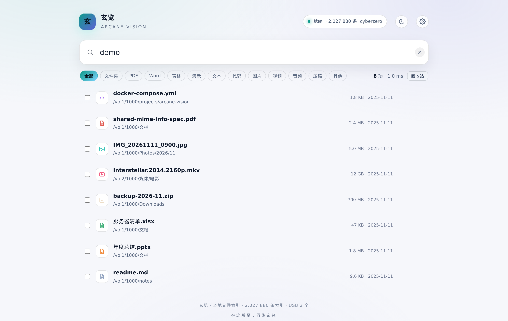
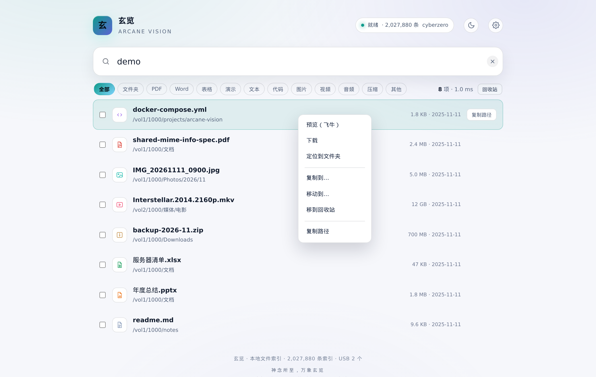
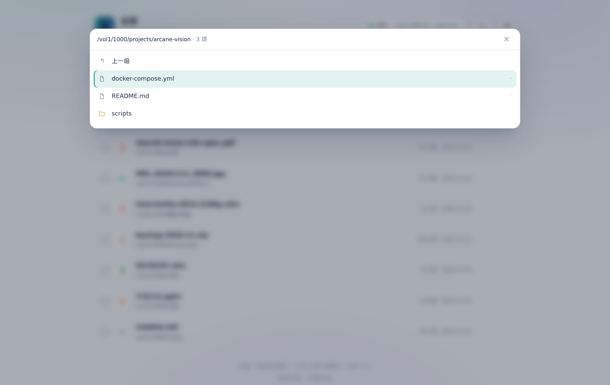
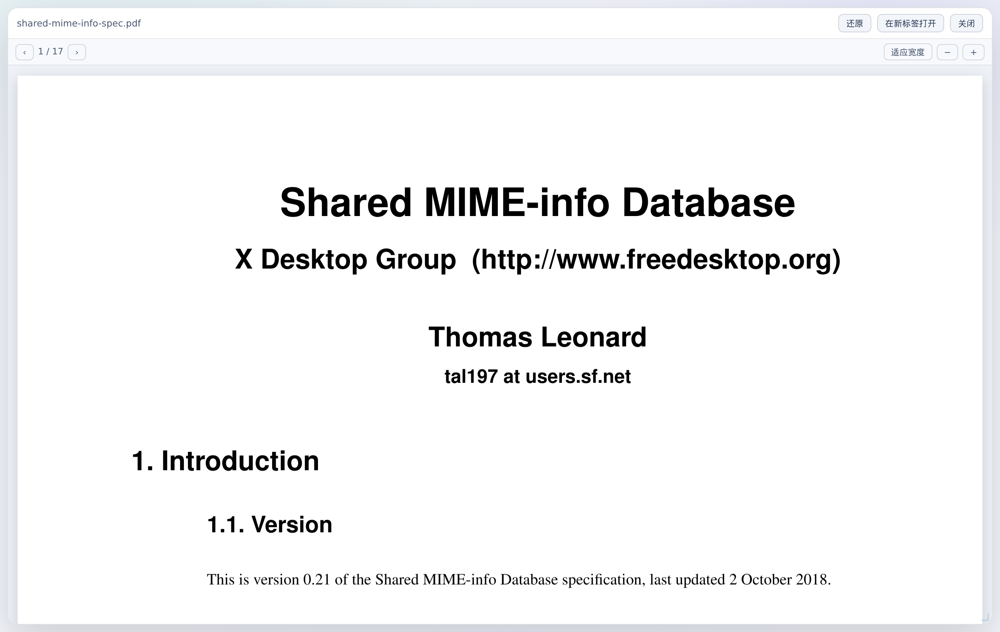
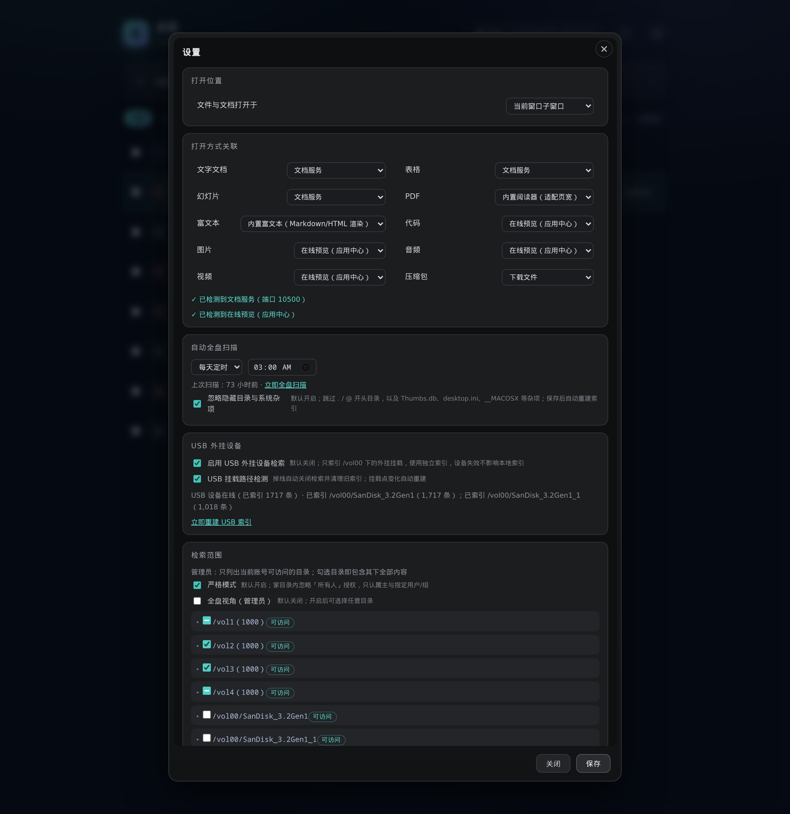

# 玄览 / Arcane Vision

> 伫中区以玄览，颐情志于典坟。 —— 陆机《文赋》

飞牛 fnOS 上的全盘文件索引与毫秒级检索引擎。全新编写，不包含任何第三方项目的源代码。

作者：cyberzero　·　神念所至，万象玄览 / Spiritual Sense, All Things Revealed

## 功能

- **毫秒级检索**：直接读 ext4 元数据建索引，500 万条目规模下 3 字符以上查询通常 0.5–7 ms；
  索引记录文件大小与 mtime，结果按真实修改时间倒序
- **多卷统一**：自动探测 /vol1–/vol8 中实际挂载的卷，最多 8 卷合并为一棵结果树，按修改时间归并
- **按账号授权**：unix socket 上的飞牛身份头才可信，TCP 必须 Cookie 认证，否则 `/api/*` 一律 401；
  逐目录按 `system.trim_acl` 求值，家目录可开「严格模式」，忽略「所有人」授权
- **类型分类**：12 类图标与筛选条（文档/表格/演示/PDF/文本/代码/图片/视频/音频/压缩包…）
- **即时预览**：内置 PDF 阅读器（按页宽适配）、EPUB 阅读器（章节/目录/图片）、
  Markdown 服务端渲染、文本/代码高亮底色、图片音视频直接播放；可关联飞牛「文档服务」
  「在线预览」；服务端转码支持 HDR→SDR 与纯音频
- **文件操作**：多选复制/移动/回收站，回收站支持恢复与清空
- **索引自维护**：fanotify 实时增量 + 定时全盘对账，索引落盘，重启秒开
- **隐藏项默认跳过**：`.` / `@` 开头的目录与文件（`@eaDir`、`.recycle` 等），以及
  `Thumbs.db`、`desktop.ini`、`__MACOSX` 等系统杂项默认不进索引；设置里可关闭，CLI 用
  `--include-hidden` 打开
- **明暗双主题**：标题栏一键切换，偏好保存在本地
- **USB 外挂检索**：可选开启（默认关、仅管理员可见），自动检测 fnOS `/vol00` 外接存储
  挂载并单独建索引；掉线自动关闭并清理，挂载路径变化自动重建，结果带 `USB` 标记
- **单文件 FPK**：随包提供 Web UI，安装后从飞牛桌面打开

## 界面

检索：输入即出结果，左侧为类型图标，右侧为大小与修改时间。



右键菜单：打开、下载、定位到文件夹、复制/移动/回收站。



定位到文件夹：在页内面板展开所在目录并高亮目标文件。



PDF 预览：内置 pdf.js，按页宽适配，可拖拽缩放或最大化。



设置：打开位置、10 类格式关联、自动全盘扫描、忽略隐藏目录与系统杂项、USB 外挂检索、检索范围与严格模式。



手机与桌面统一从飞牛网关进入：`https://<NAS>:5667/app/xuanlan/`。前端以当前页面路径解析
API、PDF worker、预览与下载地址，不依赖 `127.0.0.1:8971`。触屏下单击结果直接打开，右侧
`⋯` 打开操作面板；类型筛选横向滑动，页面滚动后右下角提供返回顶部按钮，设置与定位面板
在窄屏上占满可用高度，回收站面板贴边显示。

## PDF 阅读器

- 内置 pdf.js（Mozilla，Apache-2.0，见 `ui/vendor/LICENSE.pdfjs`），默认按页宽适配
- 设置齿轮图标取自 Feather Icons（MIT，见 `ui/vendor/LICENSE.feather-icons.txt`）
- 第三方组件与许可义务见 `THIRD_PARTY.md`，审计报告见 `docs/05-第三方与许可审计.md`
- 支持等比缩放、翻页；窗口拉宽/最大化后自动重排

## EPUB 阅读器

- `.epub` 默认使用内置阅读器，不再依赖飞牛「预览」应用；旧版 Android WebView（Chrome 83）
  也能打开
- 使用 fflate（MIT，见 `ui/vendor/LICENSE.fflate.txt`）在浏览器内解压，解析
  `container.xml` → OPF → spine，目录优先 EPUB3 `nav`、其次 EPUB2 `toc.ncx`
- 支持目录跳转、上一章/下一章、章节内锚点、跨章节链接与内嵌图片（`data:` URI）
- 安全：章节 HTML 白名单清洗（去脚本、iframe、事件属性、外链资源），iframe
  `sandbox` + CSP；DRM 加密、超大文件与 zip bomb 会被拒绝
- 限额：EPUB ≤ 64 MB、解压总量 ≤ 256 MB、生成 HTML ≤ 12 MB
- 已知不支持：DRM、分页/书签/批注、EPUB3 音视频与脚本；复杂 CSS 排版可能有差异
- 详细排查与实现见 [EPUB 预览说明](docs/07-EPUB-预览说明.md)

## Markdown 预览

- `.md`、`.markdown`、`.mdown`、`.mkd` 默认走服务端渲染，不再把源码塞进 `<pre>`
- 预览接口：`GET /api/markdown?path=/vol1/...&theme=light|dark`，返回自带主题的 HTML 页面；
  `/api/md` 是同一接口的别名
- 需要嵌入其他页面时用 `GET /api/markdown?...&format=json`，返回
  `{"ok":true,"html":"<h1>…</h1>","truncated":false}`
- 支持标题、段落、强调/删除线、行内代码、围栏代码块、引用、有序/无序列表、表格、分隔线、
  http(s)/mailto 链接与 http(s) 图片
- 安全：源文件中的原始 HTML 全部转义；`javascript:`、`data:` 等危险 URL 不生成标签；
  读取沿用文件级权限与 8 MB 上限

## 文件操作

- 结果行勾选多选：复制到…、移动到…、移到回收站
- 回收站：右上角入口，支持恢复选中与清空；删除均为移入回收站，不直接销毁
- 目标目录选择器复用 `/api/dir`，只列可访问目录

## 打开方式关联

设置 → 打开方式关联 按类型分组，每组可选择「文档服务 / 在线预览 / 内置 / 浏览器直接打开 /
下载」。0.8.5 新增 **富文本** 组：

- 覆盖 `txt`、`rtf`、`md`/`markdown`、`html`、`json`、`xml`、`log`、`ini` 等；
- 默认「内置富文本」：Markdown 服务端渲染；HTML 清洗后在 sandbox iframe 渲染（去脚本、
  事件属性与外链资源，CSP 兜底）；RTF 有文档服务时交给文档服务，否则内置纯文本解析；
  其余按文本查看；
- HTML 不会以同源页面裸渲染，即使选择「浏览器直接打开」或新窗口也一样；
- 0.8.4 的旧「文本」设置会自动映射到新的「富文本」组。

详情见 [富文本打开方式关联](docs/08-富文本关联.md)。

## 现在是什么状态

当前版本 **0.8.26**，更新记录见 [CHANGELOG.md](CHANGELOG.md)，本次发布说明见
[RELEASE_NOTES.md](RELEASE_NOTES.md)。支持明暗双主题，默认使用飞牛账号身份与系统目录授权。

### 0.8.9–0.8.17 更新内容

- 开机自启：`xuanlan.service` 改由随包 `start.sh` 读取 `service_port` / `xuanlan.conf`，
  不再写死 8971 与 `/vol1–4`
- 检索范围目录树：父级全选/半选/未选三态修正，勾选继承逐级传递，保存时收敛重复子项
- 索引默认忽略 `.` / `@` 隐藏目录与 `Thumbs.db`、`desktop.ini`、`__MACOSX` 等系统杂项，
  设置页可关闭；快照头记录扫描规则，升级自动重建
- USB 外挂设备检索：默认关闭，`/vol00` 挂载单独建索引；掉线自动关闭并清理，挂载点变化
  自动重建，结果带 `USB` 标记
- 设置页：功能区卡片化、卡片内外灰度分层、右上角关闭按钮重做

### 0.8.18–0.8.26 更新内容

- 0.8.18：修复 ext4 裸扫目录块堆越界；设置请求上限 128 KiB、检索范围上限 512；普通用户
  可保存自己的 scope；拒绝复制到自身子目录与 FIFO 阻塞；fanotify 队列满触发重建；
  USB 掉线自动关闭加 2 次防抖
- 0.8.19：搜索结果分页；目录截断提示；写接口 JSON 校验；USB 仅管理员可见、每次挂载重建；
  构建进度按线程隔离；管理员判定缓存 60 秒刷新
- 0.8.20：USB 状态消息不再向普通账号暴露挂载路径
- 0.8.21：USB 分区在检索范围树中合并为单一根节点，不再平铺分区内容
- 0.8.22–0.8.23：检索范围树只显示目录，不再显示文件数量/「没有子目录」提示，展开深度
  放开到 32 层
- 0.8.24：自动探测 `/vol1–/vol8` 实际挂载点，修复 GitHub #2 多卷只识别前 4 个；残留空目录
  不会被误当卷
- 0.8.25：USB 设备 sysfs 校验、搜索按 uid 限流、USB 状态消息加锁、快照记录边界校验、
  复制不再保留 setuid/setgid
- 0.8.26：systemd unit 按实际安装路径生成（不再写死 `/vol1`）；目录/检索范围展开改用
  parent→child 索引，只遍历直接子项

### 问题清单与下一步计划

> 更新：2026-11-10 · 状态以 `main`（0.8.26）为准。来源：0.8.17 代码审查、真机 U 盘测试、
> GitHub Issues #1/#2、README 已知限制。

#### 已完成（0.8.18–0.8.26）

- [x] P0：ext4 裸扫目录块数组堆越界（ASan + 64 MiB 镜像可复现）— 0.8.18
- [x] 设置 POST 超 16 KiB 静默截断、检索范围 64 项硬上限 — 0.8.18（128 KiB / 512 项，超限报错）
- [x] 普通用户无法保存自己的检索范围 — 0.8.18
- [x] 复制目录到自身子目录导致递归、FIFO/特殊文件阻塞 worker — 0.8.18
- [x] fanotify 内部事件队列满时静默丢事件 — 0.8.18（触发整卷重建）
- [x] USB 路径检测开关语义、掉线误判 — 0.8.18（开关同时控制重建，2 次防抖）
- [x] 搜索无分页、目录超过 4000 项无提示 — 0.8.19
- [x] 设置/文件操作/回收站 JSON 校验收紧 — 0.8.19
- [x] USB 对普通账号可见、复用过期索引快照 — 0.8.19（仅管理员、每次挂载重建）
- [x] 构建进度串扰、管理员判定永久缓存 — 0.8.19（线程隔离 / 60 秒刷新）
- [x] USB 状态消息泄漏挂载路径 — 0.8.20
- [x] USB 分区在检索范围树被平铺 — 0.8.21（按分区合并为根节点）
- [x] 只有文件的目录提示、目录树 3 层深度限制 — 0.8.22–0.8.23（只显示目录，展开 32 层）
- [x] GitHub #1「不支持外接硬盘」— 0.8.13 起支持，0.8.23 真机 SanDisk 双分区验证
- [x] GitHub #2「5 个内部卷只识别前 4 个」— 0.8.24 自动探测 `/vol1–/vol8` 实际挂载点
- [x] USB 仅按 `/vol00` 路径识别 — 0.8.25 增加 sysfs removable/USB 校验
- [x] 搜索无速率限制 — 0.8.25 每 uid 20 次/秒，2 字符 5 次/秒
- [x] USB 状态消息并发写 — 0.8.25 加锁
- [x] 快照逐记录边界校验 — 0.8.25 打开时校验 `name_off/name_len/parent`
- [x] 复制保留 setgid/setuid — 0.8.25 只保留 `0777` 权限
- [x] systemd unit / 应用中心路径写死 `/vol1` — 0.8.26 按实际安装路径生成 unit
- [x] 目录列举与检索范围展开 O(N) — 0.8.26 建立 parent→child 索引

#### 待处理

| 优先级 | 问题 | 状态 | 计划 |
|---|---|---|---|
| **P3** | unix socket 对端校验接受 www-data 组，而非仅 uid | ⬜ 待办 | 收紧为 root / geteuid / www-data uid |
| **P3** | `admin_by_uid` 仍以最小 uid≥1000 兜底 | ⬜ 待办 | 以网关头 `x-trim-isadmin` 为准，兜底可配置 |
| **P3** | README 截图过期、无 CI/HTTP API 测试 | ⬜ 待办 | 更新截图；ASan、HTTP API、USB 模拟挂载接入 CI |

#### 暂不列入短期计划（能力边界）

- USB 外挂索引没有 fanotify 实时增量，新增文件依赖手动重建或重新插拔
- USB 识别依赖飞牛把外接存储挂在 `/vol00` 下；官方调整路径需同步适配
- 不索引 SMB/CIFS、无全文检索、索引不加密、单机单进程；详见上方“已知问题与限制”

### 0.8.8 更新内容

- 打开方式关联默认值：代码/图片/音频/视频 = 在线预览，文字文档/表格/幻灯片 = 文档服务，
  PDF = 内置阅读器，富文本 = 内置富文本，压缩包 = 下载文件
- 未检测到文档服务或在线预览时，实际打开自动回退「浏览器直接打开」，不再弹安装提示；
  设置页保留原偏好并显示提示，应用装好后自动恢复

### 0.8.7 更新内容

- 修复 0.8.6 的越权显示：`Administrators` 组整卷放行后，检索范围把其他用户家目录
  （`/vol1/1001`、`/vol1/1002`…）和 `/vol1/docker` 也标成「可访问」
- 改为只对自家目录 `/volN/<uid>` 及其子路径放行读/穿越，其他家目录仍拒绝；只放行读，
  写操作仍按原 ACL
- 管理员仍能搜到 `/vol1/1000/NextCloud/data/...`（位于自己家目录内、由 www-data 持有、
  只授 owner 的子树）；`/api/acl` 对 uid 1000 只返回 `/vol1/1000` 及同 uid 的其它卷家目录

### 0.8.6 更新内容

- 修复：管理员（`Administrators` 组成员）搜不到实际可读文件。内核允许管理员组跨过
  TrimACL 读取整卷，玄览原先只按 ACE/属主判定，把 NextCloud `data` 等目录整棵过滤
- 0.8.7 将放行范围收紧为「自家目录」，避免检索范围列出其他用户家目录
- 复现与验证：以 uid 1000 搜索 `工程施工派工单` 原先返回 0 条，修正后返回 1 条；
  uid 1001 / 12345 仍返回 0 条

### 0.8.5 更新内容

- 打开方式关联新增「富文本」组：`txt/text/rtf/md/markdown/mdx/html/xhtml/json/xml/log/...`，
  可选 内置富文本 / 文档服务 / 浏览器直接打开 / 在线预览 / 下载，默认内置
- 内置富文本：Markdown 渲染、HTML 清洗后 sandbox 渲染（GBK 等编码自动识别）、RTF 纯文本解析
- 安全：HTML 去脚本/iframe/表单/事件属性/外链资源，`sandbox` + CSP，禁止同源裸渲染
- 兼容：旧 `openWith.text` 自动映射到 `rich`；`html/json/xml` 从「代码」组移入，`rtf` 从
  「文字文档」组移入，避免同一扩展名重复出现
- 细节见 [富文本打开方式关联](docs/08-富文本关联.md)

### 0.8.4 更新内容

- 新增内置 EPUB 阅读器：fflate 解压 + 解析 container/OPF/spine，支持目录、章节跳转、
  内嵌图片与跨章链接；纯前端实现，不增加服务端依赖
- 安全：章节 HTML 白名单清洗、iframe `sandbox` + CSP、DRM 检测、zip bomb 与体积限额
- 修复：0.8.3 把 EPUB 交给「预览」应用，而该应用前端使用 Chrome 85+ 的 `??=`/`||=`，
  在 Chrome 83 上语法报错、连文件接口都没发出；现在 EPUB 默认走内置阅读器
- 排障与实现细节见 [EPUB 预览说明](docs/07-EPUB-预览说明.md)

### 0.8.3 更新内容

- 新增 Markdown 预览接口与前端接入，`.md/.markdown/.mdown/.mkd` 直接渲染
- 修复旧版 Android WebView 浮层不可见：不再依赖 CSS `inset` 简写，`100dvh` 补 `vh` 回退
- EPUB/XPS/DjVu/FB2 等无内置阅读器的格式改为提示下载或转交在线预览

### 0.8.3 修复说明

荣耀（Android 10 内置 WebView，Chrome 83）上「可以搜索、点结果没反应」，不是接口问题：
网关日志显示点击后 `/api/dir`、`/api/file` 都已到达服务端并返回 200。真正原因是浮层用了
Chrome 87 才支持的 CSS `inset` 简写，旧内核直接忽略，子窗口/定位/设置面板失去位置和尺寸，
看起来就没有打开。0.8.3 改为 `top/right/bottom/left` 长写，并给 `100dvh` 补 `vh` 回退；
完整排查过程、证据与验证方法见 [0.8.3 修复说明](docs/06-0.8.3-修复说明.md)。

### 0.8.2 更新内容

- 手机端：类型筛选改为单行横向滚动，右侧保留下一项提示；结果行提供 `⋯` 操作面板；
  触屏单击直接打开，不再需要双击
- 手机端：设置、定位到文件夹、回收站面板适配安全区与 `100dvh`；设置增加固定关闭按钮，
  窄屏下打开方式下拉不再截断
- 手机端：新增一键返回顶部按钮；滚动超过 360px 显示，多选时自动隐藏
- 网关：`/app/xuanlan`、`/app/xuanlan/`、`/app/xuanlan/index.html` 三种入口均可正确解析
  API、PDF worker、预览与下载地址，不依赖 `127.0.0.1:8971`
- 修复：目录不存在时返回 `not found`，搜索跳过已删除/已卸载的索引残留路径

0.8.1 修复 SMB/ZFile 迁移目录中 mode 000 文件被误过滤、目录显示为空的问题。
### 0.8.1 修复内容

- 修复 SMB/ZFile 迁移目录中文件模式为 `000`、但属主经 TRIM ACL 仍可读时，
  目录列表把文件全部过滤掉、界面显示「该文件夹没有可见内容」的问题。
- 请求不存在的目录返回 `not found`，不再返回空列表；搜索会跳过已删除或已卸载的残留索引路径。
- 0.8.1 不改变索引格式（仍为 v2），从 0.8.0 升级不需要重新全量重建。

0.8.0 起索引升级到 v2（记录真实 `size/mtime`），从 0.7.x 升级后首次启动会自动全量重建一次；
按 4.9M 条实测约 25–30 分钟，重建期间服务可响应但结果会暂时变少。升级前建议备份 `idx` 目录。

P0–P6 已跑通：扫描（目录遍历 + ext4 裸设备）→ 建索引 → 落盘 → mmap 加载 → 查询
→ fanotify 增量 → TrimACL 求值 → HTTP 服务 + Web UI，并已打成可安装的飞牛 FPK。
全部是本仓库自己的代码，纯 C11 + glibc，服务端无第三方依赖、无 Qt。

ext4 裸设备读取器已用 `/dev/dm-1` 全卷验证：369 万条记录与 `find -xdev` 逐路径一致，
扫描 4.3 s（热）／33 s（无缓存），详见 `docs/03-P1实测.md`。

增量与权限的实现细节见 `docs/04-P2增量与ACL.md`。

## 已知问题与限制

以下问题已知、未隐藏，按影响从大到小排列。欢迎在 Issue 里补充复现条件。

**安全**

- 8971 端口只绑定 `127.0.0.1`。身份头（`X-Trim-Userid` 等）只在 unix socket 上可信；
  TCP 连接必须通过 Trim 登录 Cookie 认证，否则所有 `/api/*` 返回 401（fail-closed）。
  生产环境仍建议通过 NAS 网关（unix socket，已做 `SO_PEERCRED` 校验）访问。
- 状态变更接口（重建索引、全局设置、清空回收站）仅管理员可用；设置/文件操作/回收站写接口
  要求 `Content-Type: application/json`，防止简单表单 CSRF。
- 索引文件不加密。能读到 `<数据目录>/idx` 的人可以看到文件名、路径、大小与修改时间，但看不到文件内容。
- `serve --no-tcp` 可完全关闭回环 TCP，仅保留 unix socket；经 NAS 网关部署时建议启用。
- 索引 v2 记录真实 size/mtime；旧 v1 索引启动时会被拒绝并触发一次全量重建。

**能力边界**

- 不索引 SMB/CIFS 挂载与 `/fs`（trimafs）；网络共享需要先挂到本地卷。
- 不索引文件内容（没有全文检索）；仅按文件名、类型、路径检索。
- 服务端转码支持纯音频与 HDR→SDR（需要 ffmpeg 的 zscale 滤镜）；HDR 转换失败时回退为
  普通 8-bit 转换，颜色可能偏淡。
- 索引重建期间可能短暂保留已删除或已卸载的路径。查询会对结果做 `stat` 过滤，目录请求对
  不存在的路径返回 `not found`，但重建完成前目录视图仍可能有极短的旧记录窗口。
- 回收站不会自动过期清理，空间需要手动回收。
- 目录列举与「检索范围」授权列表仍按目录逐条扫描快照，复杂度为 O(N)；4.9M 条规模下单目录
  约 78 ms，设置页展开大量根目录时可能到秒级。后续索引会补目录/子项索引。
- 单个账号的检索范围上限为 512 项（含 `!` 排除项），超出时设置页会提示；搜索结果每页 200 条，
  可点「加载更多」续取。
- 自动探测 `/vol1–/vol8` 中实际挂载的卷，最多 8 个；超过 8 个卷时需在 `xuanlan.conf`
  写 `ROOTS` 或等待上限提升（`MAX_VOL=8`）。
- USB 外挂检索仅管理员可见；索引在启用、挂载变化或手动重建时扫描，盘内新增文件需点
  「立即重建 USB 索引」。识别依赖 fnOS 的 `/vol00` 挂载路径，并额外用 sysfs 校验 removable/USB；
  sysfs 不可用时保守接受。
- 搜索按 uid 限流：20 次/秒，2 字符查询 5 次/秒；正常输入不受影响，脚本高频调用需退避。
- 冷启动建索引耗时取决于卷类型：ext4 约 430 秒/370 万条；ZFS 因 `d_type` 不可用需逐条
  `fstatat`，22T 卷约 15–20 分钟。4.9M 条全量实测 25–30 分钟；热启动从快照加载通常 1 秒内可用。
- 内置 PDF 阅读器使用 pdf.js 4.x，需要较新的浏览器内核（Chrome 98+）。Android 10 等设备
  自带的旧 WebView（Chrome 83）无法运行，会提示更新系统 WebView 或下载后查看。
- 内置 EPUB 阅读器不支持 DRM 加密、EPUB3 音视频/脚本、分页与书签批注，复杂 CSS 排版
  可能与原书有差异；XPS/DjVu/FB2 仍只会提示下载或转交外部应用。
- 富文本内置预览中，HTML 会去掉脚本、表单、外链样式与资源并沙箱渲染，依赖 JS 的页面
  会走样；RTF 只解析纯文本（不保留粗体、表格等格式），完整排版请用「文档服务」。

**与飞牛的集成**

- 飞牛没有对外可用的「文件管理」URL，右键「定位到文件夹」只能打开应用内定位面板，
  不能唤起系统文件管理器窗口。
- 「文档服务」「在线预览」的跳转 URL 依赖这两个应用的实现，飞牛版本升级后可能变化，
  失效时会回落到内置 PDF 阅读器或 `/api/file`。
- 权限判定依赖 `system.trim_acl` 与属主规则；飞牛若调整这套语义，需要同步跟进。
- SMB/ZFile 迁移文件常以 `000` 模式出现，实际可读性由属主和 TRIM ACL 决定。0.8.1 已按显式
  ACL 与属主判定；非属主且 ACL 未授权的账号仍会被拒绝。

**部署**

- 以 root 运行（读块设备、读 `system.trim_acl`、fanotify 都需要权限）。
- 单机单进程，没有多副本与集群；索引不跨机器共享。

## 服务托管

首次启动时由 `cmd/main` 按实际 `TRIM_APPDEST` / `TRIM_PKGVAR` / `TRIM_PKGETC` 与端口生成
`/etc/systemd/system/xuanlan.service`，不再随包提供写死 `/vol1` 的 unit；装到其他卷也能正常
开机自启，unit 里的路径与 pid 文件都指向实际位置。
`ExecStart` 指向随包安装的 `start.sh`，它在每次启动（含开机自启）时读取
`/vol1/@appconf/xuanlan/service_port`（安装/配置向导写入的端口）与可选的
`/vol1/@appconf/xuanlan/xuanlan.conf`（`ROOTS=...` 覆盖索引卷），再把参数交给主程序，
因此改端口或改索引卷后重启即可生效，不需要改 unit。
应用中心的 `cmd/main` 把 `status / start / stop` 委派给 `systemctl`，兜底启动同样走
`start.sh`，两套入口指向同一个进程，不会出现「应用中心显示已退出、实际还在跑」、
两个实例抢 socket、或开机与手动启动参数不一致的情况。

```bash
systemctl status xuanlan      # 查看状态
systemctl restart xuanlan     # 重启（索引从快照加载，秒开）
journalctl -u xuanlan -n 50   # 查看日志
```

## 构建

```
make            # 产出 bin/xuanlan
make install    # 装到 /usr/local/bin
```

只需要 gcc 或 clang。

## 用法

```bash
# 建索引
bin/xuanlan build --root /vol1/1000 --out /vol4/@appdata/xuanlan/index.xl \
                  --exclude /vol1/docker

# 直接从块设备读 ext4（需 root，路径前缀取挂载点或 --root）
bin/xuanlan build --device /dev/dm-1 --out /vol4/@appdata/xuanlan/vol1.idx -v

# 查询
bin/xuanlan query --index /vol4/@appdata/xuanlan/index.xl -n 20 报告
bin/xuanlan query --index /vol4/@appdata/xuanlan/index.xl --files --json .mkv

# 启动服务（网关 socket + Web UI）；--no-tcp 可完全关闭回环 8971
# --exclude 可重复；存在排除项时 ext4 裸扫会自动退回目录遍历
bin/xuanlan serve --roots /vol1,/vol2,/vol3,/vol4 --index-dir /vol4/@appdata/xuanlan \
                 --exclude /vol1/docker --no-tcp

# 判定某用户能否列某目录（TrimACL 求值）
bin/xuanlan acl 900 /vol1/1000 /vol1/vm

# 看索引元数据 / 导出全部路径
bin/xuanlan info --index /vol4/@appdata/xuanlan/index.xl
bin/xuanlan dump --index /vol4/@appdata/xuanlan/index.xl
```

查询串是大小写不敏感的子串匹配，中文按 UTF-8 字节处理，无需分词；少于 2 个字符的查询会直接拒绝。

## 实测基线（飞牛 fnOS 环境，2026-11）

`/vol1/@appcenter`，173,128 条记录：

| 项 | 结果 |
|---|---|
| 扫描（页缓存热） | 253 ms |
| 建 trigram 索引 | 424 ms |
| 倒排编码后体积 | 3.5 MB（**1.29 B/posting**） |
| 快照文件 | 10.1 MB |
| 全流程 | 686 ms |
| 查询 `screenshot` / `docker-compose` | < 1 ms |
| 单字符查询 | 直接拒绝（避免全 names 池扫描） |

与 `find` 逐条比对：记录数与 `find -xdev` 完全一致（173,128），
12 个 `docker-compose` 命中一致，输出路径全部存在。

`/vol1` 全卷（`/dev/dm-1`，369 万条）：扫描 4.3 s、建索引 8.8 s、快照 247 MB，
常见词查询 1–7 ms，`json`（9.2 万命中）62 ms。

冷建瓶颈是 ext4 元数据的寻道次数，不是吞吐（见 `docs/01-架构.md`）。

## 目录

```
src/xl.h          公共类型、快照头、接口
src/util.c        内存、ASCII 折叠、大小写不敏感查找
src/scan.c        getdents64 扫描器（DFS 先序）
src/index.c       trigram 稀疏表 + 分块位打包倒排
src/snapshot.c    单文件快照，4KB 对齐段，mmap 直用
src/query.c       候选求交、全名复核、Top-K、路径还原
src/fsreader_ext4.c  ext4 裸设备读取（inode 位图 + extent 树 + 物理序目录块）
src/httpd.c       HTTP/unix socket 服务、多卷快照、增量合并
src/live.c        fanotify 增量（DFID 句柄还原 + delta 表）
src/perm.c        TrimACL 二进制求值 + 继承 + POSIX 回落
src/main.c        CLI / serve
docs/             架构、合规与净室说明
CHANGELOG.md      版本更新记录
RELEASE_NOTES.md  最新发布说明
tests/smoke.sh    冒烟测试
tests/ext4_image_test.sh  裸设备读取器与 getdents/find 的一致性测试
pkg/              FPK 打包源（manifest、cmd、wizard、ui、config）
scripts/build-fpk.sh      打包装包
```

## 版本与安装包

- 最新版本：**0.8.26**（2026-11-10）
- 安装包：`xuanlan_0.8.26_amd64.fpk`（928,294 字节）
- MD5：`fdce961d3f93f86cf6d881bfd2b4d3fc`
- SHA-256：`cbf660ef9f430be091a11b55aa50c0b2340e6f7b86b4dc27ececac6c18ed6ab2`
- 发布页：[GitHub](https://github.com/magicindex/ArcaneVision/releases/tag/v0.8.26) ·
  [Gitea](http://192.168.3.200:3000/cyberzero/ArcaneVision/releases/tag/v0.8.26)

## 路线图

- **P0 已完成**：扫描、索引、快照、查询、CLI
- **P1 已完成**：ext4 裸设备扫描器（按公开的 on-disk 格式规范自行实现，顺序读 inode 表后按物理块推进），冷建从 15 分钟降到约 7 分钟/370 万条
- **P2 已完成**：fanotify 文件系统标记增量 + 周期对账（默认 6 小时）
- **P3 已完成**：TrimACL 求值通过样本与真机验证；身份取自飞牛会话头 `X-Trim-Userid`，多用户结果按权限过滤
- **P4 已完成**：Web UI、FPK 打包；已在飞牛 fnOS 真机安装运行，登录身份与目录授权均取自系统
- **P5 已完成（0.7.x）**：明暗双主题、安全加固（socket 对端校验、软链逃逸、回收站路径）、
  服务生命周期与应用中心状态对齐
- **P6 已完成（0.8.9–0.8.17）**：开机自启参数化、目录树三态、隐藏/杂项过滤、USB 外挂检索、
  设置页视觉整理
- **P7 已完成（0.8.18–0.8.26）**：P0 越界与设置/文件操作安全加固、搜索分页、USB 真机适配、
  分区根节点与目录树深度整理
- **P6 已完成（0.8.0）**：索引 v2 记录真实 `size/mtime` 并按真实时间排序；目录增量子树；
  fail-closed 身份与文件级读写权限；HDR/纯音频转码；`--no-tcp`；查询 Top-K 与快照加固
- **下一步（0.9.x）**：索引加密、SMB/CIFS 与全文检索、目录/ACL 的 O(N) 优化

## 许可

本项目以 **GPL-3.0** 发布，全文见 [LICENSE](LICENSE)。

- 第三方组件：pdf.js（Apache-2.0）、Feather Icons 图标路径（MIT），
  其版权与许可文本见 [THIRD_PARTY.md](THIRD_PARTY.md)、[NOTICE.md](NOTICE.md)，随二进制包分发；
- 仅在自行部署（不对外分发二进制）时，GPL 不施加额外义务；
- 分发二进制时须提供对应源码，获取地址见 [NOTICE.md](NOTICE.md)。

## 合规

本项目为净室重写：未复制、未改编任何现有搜索引擎（包括 Everything、kerything）的源代码，
仅在阅读公开文档与公开接口的基础上自行实现。细节与依赖清单见 [docs/02-版权与净室.md](docs/02-版权与净室.md)。
